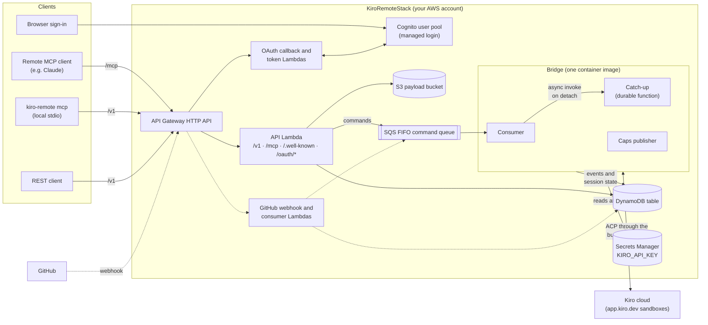

# kiro-remote operator guide

This is the index for operating kiro-remote: deploying it, testing it, creating a
user, and driving it through the REST API or the MCP server.

kiro-remote is a personal AWS control plane that launches and drives Kiro Web
sessions using the engine bundled with `kiro-cli` over ACP (`kiro-cli` is
installed at image build time, not run at runtime). You deploy a
single CDK stack (`KiroRemoteStack`) into your own AWS account. It exposes:

- a **REST API** under base path `/v1`, fronted by an OAuth 2.1 / Cognito facade,
- an **MCP server** (stdio via the `kiro-remote` CLI, and Streamable HTTP at
  `<host>/mcp`),

both backed by a serverless **bridge**: three container-image Lambda functions
built from one image. An SQS consumer launches and drives Kiro cloud sessions
over ACP against kiro-cli's bundled engine, a durable catch-up function follows
turns that outlive one consumer invocation, and a publisher records the
engine's capabilities (see
[deploy.md](./deploy.md#how-the-lambda-path-drives-cloud-sessions-direct-engine)).

## How the pieces fit together



Every client reaches the stack through one API Gateway HTTP API. The API
Lambda serves `/v1`, `/mcp`, the discovery documents and most of `/oauth/*`;
two small Lambdas handle the OAuth callback and the token exchange with
Cognito. Requests to `/v1` and `/mcp` carry a Cognito access token, which the
API Lambda verifies itself. Writes become commands on the FIFO queue, and the
bridge consumer runs them against Kiro cloud through the engine bundled in its
image. A turn that outlives one consumer invocation is finished by the durable
catch-up function. The caps publisher runs after each deploy and every 6 hours.
The dashed path is the optional [GitHub wake](./github.md).

## What to do next

If you have just merged or checked out this project and want to get it running,
work through the guides in this order:

1. **[Deploy the control plane](./deploy.md)** — install the toolchain, supply
   your `KIRO_API_KEY`, and `cdk deploy` the stack into your AWS account. This is
   the prerequisite for everything else; the REST API and MCP server only exist
   once the stack is deployed.
2. **[Register a user](./users.md)** — a user **is** required. Sign-up is operator
   driven (there is no public signup): you invite yourself with
   `scripts/invite-user.sh`, bootstrap a passkey from the emailed code, and sign
   in with that passkey from then on (no password is ever issued; the email-code
   factor stays usable, see [users.md](./users.md)).
3. **[Try the REST API](./rest-api.md)** — log in to get a token, then call
   `/v1/capabilities`, launch a session, and long-poll its events with `curl`.
4. **[Use the MCP server](./mcp.md)** — run `kiro-remote login` once, then wire
   `kiro-remote mcp` into your MCP client as a stdio server (or point a Streamable
   HTTP MCP client at `<host>/mcp`).
5. **[Run the tests](./testing.md)** — unit/integration tests run offline; the
   live `e2e` harness needs a deployed stack.
6. **[Optional: GitHub wake](./github.md)** — register a read-only GitHub App so
   pull request activity (merged, review, comment, failing checks) wakes the
   session that opened the PR.

## Observability

All Lambdas share one Powertools for AWS Lambda setup (structured redacted logs, EMF metrics, X-Ray tracing). See [deploy.md](./deploy.md#observability).

## Two different credentials (don't mix them up)

kiro-remote involves two unrelated secrets. Keeping them straight avoids most of
the confusion:

| Credential                 | What it is                                                                          | Where it lives                                                      | Used for                                                                                       |
| -------------------------- | ----------------------------------------------------------------------------------- | ------------------------------------------------------------------- | ---------------------------------------------------------------------------------------------- |
| `KIRO_API_KEY` (`ksk_...`) | Your personal Kiro API key from [app.kiro.dev](https://app.kiro.dev) → **API Keys** | AWS Secrets Manager, read at runtime by the bridge Lambda functions | The bridge's own credential for Kiro, used by the bundled engine. **Never** a REST/MCP bearer. |
| Cognito OAuth access token | A short-lived (15 min) bearer minted by the Cognito facade after you log in         | Your machine's keychain (via `kiro-remote login`)                   | The `Authorization: Bearer <token>` you send to `/v1/*` and `/mcp`.                            |

The `ksk_` key never leaves the server side and is never passed to the REST API or
MCP. The OAuth token is what _you_ present to the API.

## Regions

The stack region comes from the standard CDK environment variables
(`CDK_DEFAULT_ACCOUNT` / `CDK_DEFAULT_REGION`). Kiro cloud sandboxes are
provisioned by Kiro cloud ([app.kiro.dev](https://app.kiro.dev)), not by your
stack, so their region is managed by Kiro and is independent of where your stack is
deployed.

## Toolchain

- Node **26.13.0** and pnpm **12.18.0**, pinned in [`.mise.toml`](../.mise.toml).
- ESM throughout; TypeScript is executed directly via Node 26 native type
  stripping, so there is no separate compile step.
- The API and OAuth callback Lambdas target the matching **Node 26** runtime
  (`nodejs26.x`; the bridge Lambdas are container images), which AWS lists as **public preview** (not SLA/Support-covered, not for
  production, GA targeted ~Nov 2026). CDK has no `Runtime.NODEJS_26_X` constant
  yet ([aws/aws-cdk#39021](https://github.com/aws/aws-cdk/issues/39021)) so a
  shim is used. See [`deploy.md`](./deploy.md#lambda-runtime-node-26-public-preview)
  for the full note.
- [mise](https://mise.jdx.dev) provisions the pinned Node and pnpm. The examples
  below use `mise exec -- pnpm ...`; if you manage Node/pnpm yourself you can drop
  the `mise exec --` prefix.

## Repository layout

```
packages/core     shared zod schemas, auth primitives, domain types
packages/auth      Cognito OAuth 2.1 facade construct + handlers
packages/bridge    Lambda bridge: SQS consumer, durable catch-up, caps publisher (ACP to kiro-cli's engine)
packages/api       REST API (/v1) + facade routing + /mcp + /openapi.json
packages/github    optional GitHub App webhook ingress, event routing, PR links
packages/mcp       the `kiro-remote` CLI and the MCP tools/transports
packages/cdk       the CDK app and KiroRemoteStack
e2e                a live end-to-end harness (needs a deployed stack)
```

## Getting help

For bugs, questions, and feature requests, open a
[GitHub issue](https://github.com/nikovirtala/kiro-remote/issues). For anything
not suited to a public issue, email the maintainer at
[niko.virtala@hey.com](mailto:niko.virtala@hey.com). See the root README's
[Getting help](../README.md#getting-help) section and, for security-sensitive
reports, [SECURITY.md](../SECURITY.md).
