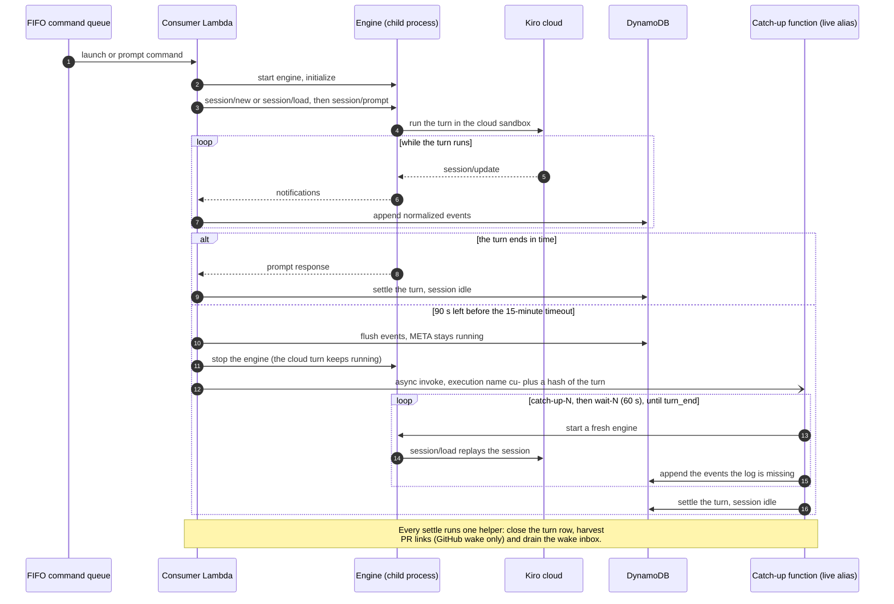
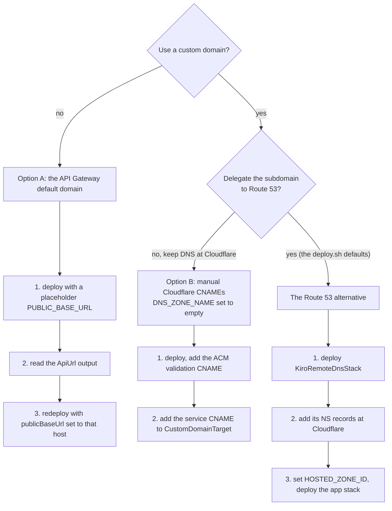
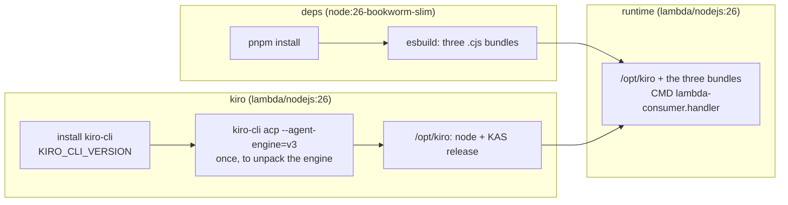

# Deploying the control plane

This guide deploys the single `KiroRemoteStack` into your AWS account with the
AWS CDK. When it finishes you will have a reachable REST API, an MCP endpoint, and
a running bridge.

## Prerequisites

- An AWS account and credentials configured for the AWS CLI / CDK (the stack is
  deployed into the account and region resolved from your environment).
- The pinned toolchain: Node **26.13.0** and pnpm **12.18.0** (see
  [`.mise.toml`](../.mise.toml)). With [mise](https://mise.jdx.dev):

  ```bash
  mise install
  ```

- A container runtime that can build a `linux/arm64` OCI image (Docker or a
  compatible builder). The bridge image
  ([`packages/bridge/Dockerfile.lambda`](../packages/bridge/Dockerfile.lambda)) is
  built as part of a production deploy. See [Building the bridge image](#building-the-bridge-image).
- Your personal **Kiro API key** (`ksk_...`) from
  [app.kiro.dev](https://app.kiro.dev) → **API Keys**. It becomes the bridge's
  credential for Kiro and is stored in Secrets Manager, never on the command
  line or in the image.

## 1. Install dependencies

From the repository root:

```bash
mise exec -- pnpm install
```

## 2. Build and sanity-check

TypeScript runs via Node type stripping, so `build` only type-checks; it does not
emit artifacts. The CDK unit tests synthesize the stack with test props and run
the cdk-nag checks, with no Docker and no AWS credentials:

```bash
mise exec -- pnpm build
mise exec -- pnpm --filter @nikovirtala/kiro-remote-cdk test
```

`pnpm synth` runs `./scripts/deploy.sh --synth`: a `cdk synth` with exactly the
settings a deploy would use (your `deploy.env`, region, and account checks). It
bundles the real API Lambda, stages the bridge image's Docker build context in
`cdk.out`, and runs the cdk-nag checks against the real asset constructs. It
needs AWS credentials but not Docker (the image is built at deploy), and it
deploys nothing. Set up `deploy.env` first (see
[Bootstrap and deploy](#5-bootstrap-and-deploy)).

The CDK app has **no defaults** for its deploy context. It refuses to synthesize
(so `cdk deploy`/`cdk diff` refuse to run) unless `publicBaseUrl`,
`cognitoDomainPrefix`, `allowedRepos`, `kiroApiKeySecretArn` and `kiroCliVersion`
are all set. This stops a context-free `cdk deploy` from replacing a live stack
with placeholders.

### Lambda runtime: Node 26 (public preview)

The stack targets **Node 26** on every Lambda, matching the Node 26.13.0
toolchain pinned in [`.mise.toml`](../.mise.toml):

- The managed (zip) API and OAuth Lambdas run on the `nodejs26.x` managed
  runtime. aws-cdk-lib does not yet expose a `Runtime.NODEJS_26_X` constant
  ([aws/aws-cdk#39021](https://github.com/aws/aws-cdk/issues/39021)), so the
  construct uses a small shim (`new Runtime("nodejs26.x", RuntimeFamily.NODEJS,
  { supportsInlineCode: true })`) until that constant ships.
- The bridge image
  ([`packages/bridge/Dockerfile.lambda`](../packages/bridge/Dockerfile.lambda))
  is built on the `public.ecr.aws/lambda/nodejs:26` Lambda base.

> **Preview caveat.** AWS lists `nodejs26.x` (and its `public.ecr.aws/lambda/nodejs:26`
> base image) as a **PUBLIC PREVIEW** runtime: it is **not covered by the AWS
> Lambda SLA or AWS Support**, is **not recommended for production**, and GA is
> targeted for around **November 2026** (see the
> [AWS Lambda runtimes docs](https://docs.aws.amazon.com/lambda/latest/dg/lambda-runtimes.html)).
> Node 26 is the default here because the repo pins 26.13.0 and is built to run
> on Node 26, but a production operator should weigh the preview status before
> deploying.

## 3. Choose your deploy context

The CDK app ([`packages/cdk/bin/app.ts`](../packages/cdk/bin/app.ts)) reads its
deploy context from `-c key=value` flags. Five keys are required:
`publicBaseUrl`, `cognitoDomainPrefix`, `allowedRepos`, `kiroApiKeySecretArn`
and `kiroCliVersion`. The rest are optional:

> **Real assets, `-c kiroCliVersion=<ver>` (required).** This flag drives BOTH
> real production assets: the bridge Dockerfile's `KIRO_CLI_VERSION` build arg
> has **no default**, so without a concrete version there is nothing to build
> the real image from. With it:
>
> - the app **builds the real bridge Lambda image locally** from
>   [`packages/bridge/Dockerfile.lambda`](../packages/bridge/Dockerfile.lambda)
>   via `DockerImageCode.fromImageAsset` with the repo root as the build
>   context, `platform: linux/arm64` (Graviton) and
>   `buildArgs: { KIRO_CLI_VERSION }`.
>   This **needs a working Docker/container runtime** on the machine running
>   `cdk deploy` (synth only stages the build context), and it builds
>   `linux/arm64`; and
> - the app **bundles the real API Lambda** (`src/lambda/entry.ts`) in-process
>   with esbuild and passes it as `apiLambdaCode`. The bundle is **headless, no
>   Docker** (esbuild is a workspace dev dependency).
>
> This repo's CDK app refuses to synthesize without it. The `KiroRemote`
> construct itself still falls back to a placeholder bridge image and an inline
> placeholder API Lambda when no real assets are passed; that is what the CDK
> unit tests use. The kiro-cli version is **operator-supplied** (`KIRO_CLI_VERSION`
> in `deploy.env`) and never hardcoded in the CDK code.
>
> The real bridge image build is the only step that needs Docker; run the
> deploy on a machine that has it (the API Lambda bundle itself runs anywhere
> esbuild does). A blank/empty `kiroCliVersion` is rejected with a clear error.
>
> Example real deploy (combining the version with this repo's custom-domain
> context):
>
> ```bash
> pnpm --filter @nikovirtala/kiro-remote-cdk deploy -- \
>   -c kiroCliVersion=3.1.0 \
>   -c publicBaseUrl=https://kiro-remote.nikovirtala.dev \
>   -c customDomainName=kiro-remote.nikovirtala.dev \
>   -c hostedZoneId=<HostedZoneId output>
> ```
>
> **CONFIG#CAPS caveat:** until the caps publisher first writes the
> `CONFIG#CAPS` item, `GET /capabilities` and `GET /models` return the
> empty-capabilities fallback. The publisher runs right after each deploy (a
> CDK Trigger) and then every 6 hours, so this resolves shortly after a fresh
> deploy.

| Context key           | Default                                 | Meaning                                                                                                                                                                                                                                                                                                                                                                                                      |
| --------------------- | --------------------------------------- | ------------------------------------------------------------------------------------------------------------------------------------------------------------------------------------------------------------------------------------------------------------------------------------------------------------------------------------------------------------------------------------------------------------ |
| `publicBaseUrl`       | — (required)                            | The canonical `https://<host>` **without** a trailing slash. Use a custom domain fronting the HTTP API, or the API Gateway default domain `https://<api-id>.execute-api.<region>.amazonaws.com`. Used verbatim for the RFC 9728 PRM, the RFC 8414 AS-metadata issuer, the Cognito resource identifier (`<host>/mcp`), and the CIMD allow-list, so for a real deploy it **must** be the real, reachable host. |
| `sesFromEmail`        | — (Cognito default sender; synth warns) | SES sender for the user pool. Required in practice: invited users sign in with an emailed one-time code, which the default sender does not deliver. The address or its domain must be verified in SES in the stack region. `sesVerifiedDomain` optionally names a different verified domain.                                                                                                                 |
| `cognitoDomainPrefix` | — (required)                            | The Cognito managed-login domain prefix. The hosted UI is served from `<prefix>.auth.<region>.amazoncognito.com`.                                                                                                                                                                                                                                                                                            |
| `allowedRepos`        | — (required)                            | Comma-separated GitHub repo globs the bridge may launch sessions against. Launches outside this list are rejected with 403.                                                                                                                                                                                                                                                                                  |

Three more context keys drive the optional custom domain (unset in the CDK app;
`scripts/deploy.sh` defaults `customDomainName`/`dnsZoneName` to the scoped
subdomain `kiro-remote.nikovirtala.dev`):

| Context key        | Default                        | Meaning                                                                                                                                                                                                                                                                                                                                      |
| ------------------ | ------------------------------ | -------------------------------------------------------------------------------------------------------------------------------------------------------------------------------------------------------------------------------------------------------------------------------------------------------------------------------------------- |
| `customDomainName` | — (default execute-api domain) | The custom host fronting the HTTP API. When set, the stack creates (or imports) a regional ACM cert and an API Gateway v2 custom domain. See [Option B](#option-b--a-custom-domain-recommended).                                                                                                                                             |
| `dnsZoneName`      | — (no DNS stack)               | When set, `bin/app.ts` also synthesizes `KiroRemoteDnsStack`: a Route 53 **public hosted zone** for a delegated subdomain. Only needed for the automated Route 53 alternative; harmless otherwise (the zone is a separate stack you deploy or ignore). See [the Route 53 alternative](#automated-alternative--route-53-delegated-subdomain). |
| `hostedZoneId`     | — (zone-less manual CNAME)     | Id of a Route 53 public hosted zone owning `customDomainName` (typically the `HostedZoneId` output of `KiroRemoteDnsStack`). When set, the app stack validates the cert against that zone **and** creates the alias records in it — no manual DNS. Omit for the manual-Cloudflare path. Account-specific; set it in `deploy.env`.            |

> **About `publicBaseUrl` and the chicken-and-egg with the API Gateway default
> domain:** if you are not using a custom domain, the default domain only exists
> after the HTTP API is created. A common approach is to deploy once with any
> placeholder `PUBLIC_BASE_URL` to create the API, read the generated API Gateway domain,
> and then redeploy with `-c publicBaseUrl=https://<api-id>.execute-api.<region>.amazonaws.com`
> so the PRM/AS-metadata/CIMD values all match the real host. Using a custom
> domain avoids the second deploy. The two paths are laid out in full in
> [Pointing `publicBaseUrl` at the API](#pointing-publicbaseurl-at-the-api).

[`packages/cdk/cdk.json`](../packages/cdk/cdk.json) holds only CDK feature
flags, no deploy values. Set the values in a gitignored `deploy.env` at the repo
root and deploy with [`scripts/deploy.sh`](../scripts/deploy.sh), which maps each
`deploy.env` key to its `-c` flag (see [Bootstrap and deploy](#5-bootstrap-and-deploy)).
You can still pass `-c key=value` directly to the CDK CLI for one-off synths.

| `deploy.env` key             | Context key              |
| ---------------------------- | ------------------------ |
| `KIRO_CLI_VERSION`           | `kiroCliVersion`         |
| `PUBLIC_BASE_URL`            | `publicBaseUrl`          |
| `COGNITO_DOMAIN_PREFIX`      | `cognitoDomainPrefix`    |
| `ALLOWED_REPOS`              | `allowedRepos`           |
| `CUSTOM_DOMAIN_NAME`         | `customDomainName`       |
| `DNS_ZONE_NAME`              | `dnsZoneName`            |
| `HOSTED_ZONE_ID`             | `hostedZoneId`           |
| `HOSTED_ZONE_NAME`           | `hostedZoneName`         |
| `CERTIFICATE_ARN`            | `certificateArn`         |
| `KIRO_API_KEY_SECRET_ARN`    | `kiroApiKeySecretArn`    |
| `SES_FROM_EMAIL`             | `sesFromEmail`           |
| `SES_VERIFIED_DOMAIN`        | `sesVerifiedDomain`      |
| `GITHUB_APP_SECRET_ARN`      | `githubAppSecretArn`     |
| `GITHUB_TRUSTED_LOGINS`      | `githubTrustedLogins`    |
| `GITHUB_AGENT_LOGINS`        | `githubAgentLogins`      |
| `GITHUB_PR_TRAILER`          | `githubPrTrailer`        |
| `GITHUB_AUTO_CLOSE_ON_MERGE` | `githubAutoCloseOnMerge` |

The five `GITHUB_*` keys belong to the optional [GitHub wake](./github.md)
feature. Leave `GITHUB_APP_SECRET_ARN` blank and nothing is deployed for it.

> **Allow-list glob gotcha:** repos are matched as `owner/name`, where a single
> `*` matches any run of characters **except** `/`, and `**` matches across `/`.
> So `*` on its own matches nothing of the form `owner/name` and would reject
> every launch with a 403 — use `*/*` (any owner, any name) or `**` to allow all.
> To scope to your own repos, use e.g. `nikovirtala/*`, or a comma-separated list
> like `nikovirtala/kiro-remote,nikovirtala/other` (no spaces).

### Other construct options

Additional options exist on `KiroRemoteProps`
([`packages/cdk/src/construct.ts`](../packages/cdk/src/construct.ts)). The app
entrypoint wires only the context keys above; to set the props below you edit
`bin/app.ts` (or your own thin app) and pass them to the stack. The most useful:

| Prop                   | Default                                   | Meaning                                                                                                                                                                                                                                                                                                                                                                                                                                                                                                                                        |
| ---------------------- | ----------------------------------------- | ---------------------------------------------------------------------------------------------------------------------------------------------------------------------------------------------------------------------------------------------------------------------------------------------------------------------------------------------------------------------------------------------------------------------------------------------------------------------------------------------------------------------------------------------- |
| `cimdAllowedHosts`     | facade host + `claude.ai` always included | Extra hosts permitted as CIMD `client_id` URL hosts.                                                                                                                                                                                                                                                                                                                                                                                                                                                                                           |
| `maxCloudSessions`     | `10`                                      | Concurrent cloud-session cap (includes IDE/Web usage).                                                                                                                                                                                                                                                                                                                                                                                                                                                                                         |
| `eventTtlDays`         | `30`                                      | Event TTL in days.                                                                                                                                                                                                                                                                                                                                                                                                                                                                                                                             |
| `kiroCliVersion`       | —                                         | The `kiro-cli` version baked into the Lambda bridge image via the `KIRO_CLI_VERSION` build arg (which has no default). Also the single opt-in trigger for the real assets (see the [real-asset opt-in callout](#3-choose-your-deploy-context)). Operator-supplied, never hardcoded; required for a real deploy.                                                                                                                                                                                                                                |
| `preRegisteredClients` | —                                         | A list of `{ name, callbackUrls }` public OAuth clients (e.g. Claude Code, VS Code) that authorize through the facade without a CIMD document. Each client presents its `name` as the `client_id` at `/oauth/authorize` and may only use the listed `callbackUrls` as `redirect_uri`. The stack provisions a Cognito app client for each and propagates the id + redirect URIs into the API Lambda so the facade accepts them at runtime.                                                                                                      |
| `kiroApiKeySecretArn`  | — (construct creates an empty secret)     | Full ARN of a **pre-existing** Secrets Manager secret holding the `ksk_` key. **Recommended for real deploys:** the construct imports it and grants the bridge functions read; they resolve it at runtime via `KIRO_API_KEY_SECRET_ARN`. Because it is external it **survives a stack rollback**. Omit it and the construct creates an empty secret (synth/dev only) that you must populate and that is destroyed on rollback. Also wired from the `kiroApiKeySecretArn` context key. See [Store the Kiro API key](#4-store-the-kiro-api-key). |
| `customDomain`         | — (default execute-api domain only)       | `{ domainName, certificateArn?, hostedZoneId?, zoneName? }`. When set, the stack creates (or imports) a regional ACM cert and an API Gateway v2 custom domain mapped to the HTTP API. Supply `hostedZoneId` + `zoneName` to validate the cert against a Route 53 zone and create alias `A`/`AAAA` records in it (no manual DNS); omit them for the zone-less manual-CNAME path. See [Pointing `publicBaseUrl` at the API](#pointing-publicbaseurl-at-the-api).                                                                                 |
| `lambdaImage`          | placeholder ECR image                     | Override the bridge Lambda container image. A factory `(cmd) => DockerImageCode` called once per function (consumer, catch-up, caps publisher) so each runs its own handler from the one image. Production deploys pass a factory wrapping `DockerImageCode.fromImageAsset(repoRoot, { file: "packages/bridge/Dockerfile.lambda", buildArgs: { KIRO_CLI_VERSION }, platform: linux/arm64, cmd })`. Gated behind `-c kiroCliVersion`.                                                                                                           |
| `apiLambdaCode`        | inline placeholder                        | Override the API Lambda code with your bundled asset.                                                                                                                                                                                                                                                                                                                                                                                                                                                                                          |

> The defaults for `lambdaImage` and `apiLambdaCode` are
> placeholders so the construct synthesizes with no Docker build and no
> bundling step (the CDK unit tests rely on this). A production deploy must
> override them (image + Lambda code) so the stack actually serves traffic; this
> repo's app always does, from the required `kiroCliVersion`.

## The Lambda bridge

The bridge is serverless. Every deploy provisions:

- the **consumer**, a container-image Lambda function (arm64) that consumes the
  SQS FIFO command queue and launches and drives cloud sessions;
- the **catch-up function**, a durable function from the same image
  (`catch-up-durable.handler`) that follows detached turns to their end;
- the **caps publisher**, a third function from the same image that writes
  `CONFIG#CAPS`, invoked once right after deploy (a CDK Trigger custom
  resource) and then on a 6-hour schedule.

All three talk ACP directly to kiro-cli's bundled engine (see
[direct engine](#how-the-lambda-path-drives-cloud-sessions-direct-engine)).
There is no VPC and no long-running task. Operational details:

- **Image.** All three functions run the container image built from
  [`packages/bridge/Dockerfile.lambda`](../packages/bridge/Dockerfile.lambda)
  (arm64, with the consumer, catch-up and caps-publisher handler bundles). It is built
  from the required `-c kiroCliVersion=<ver>`, so deploy needs Docker. A build
  stage installs that kiro-cli version and runs `kiro-cli acp --agent-engine=v3`
  once to unpack its bundled engine: the `node` binary goes to `/opt/kiro/node`
  and the engine release directory to `/opt/kiro/kas/<ver>-<hash>`, with
  `/opt/kiro/kas/current` symlinked to it. The build fails loudly when `node`
  or `acp-server.js` is missing. The runtime stage copies only `/opt/kiro`;
  kiro-cli itself is not in the runtime image. See
  [Building the bridge image](#building-the-bridge-image).
- **Catch-up function.** A Lambda durable function (arm64, same memory as the
  consumer, 5-minute function timeout, which only has to cover one `session/load`
  round). Its durable config has an execution timeout of 6 h 30 min (the 6 h
  catch-up expiry plus a margin, so the code's own check fires first) and a
  14-day retention period. A durable function must be invoked through a
  qualified ARN, so CDK publishes a version and an alias `live`; the consumer
  gets the alias ARN as `CATCH_UP_FUNCTION_ARN` and `lambda:InvokeFunction` on
  that alias only. Versions are retained (`RemovalPolicy.RETAIN`) because an
  execution stays pinned to the version that started it for up to 6 h 30 min.
  The role gets the table, bucket, Kiro API key secret and, with the GitHub
  feature, the command and GitHub queues, plus
  `lambda:CheckpointDurableExecution` and `lambda:GetDurableExecutionState`
  scoped to the function's own ARN with a version wildcard (`<arn>:*`). It uses
  an explicit role, so CDK does not attach the broader AWS managed
  `AWSLambdaBasicDurableExecutionRolePolicy`. It has no event-source mapping.
- **Concurrency.** `maxCloudSessions` maps to the consumer function's RESERVED
  CONCURRENCY. Because the queue is FIFO and the producer sets
  `MessageGroupId = sessionId`, SQS already serializes work per session; the
  reserved concurrency caps how many DISTINCT sessions run in parallel.
- **Visibility timeout.** The command queue's visibility timeout is 15 minutes
  (the consumer's timeout), so a long cloud turn is not redelivered mid-flight.
- **Capabilities publish.** Until the first publish succeeds,
  `GET /capabilities` and `GET /models` return the empty-capabilities fallback
  (see the CONFIG#CAPS caveat above). A transient failure self-heals on the
  next scheduled run.
- **Secret.** The functions resolve `KIRO_API_KEY` at runtime from Secrets
  Manager via the `KIRO_API_KEY_SECRET_ARN` environment variable; the function
  roles are granted read on that exact secret. `AWS_REGION` is a reserved
  Lambda variable and is never set by the construct.

### Operations cloud sessions do not support

All 16 MCP tools and every REST route stay available, but some operations have
no meaning on a cloud session:

- **cancel** is rejected while a turn is running and is a no-op when the
  session is idle. The turn runs to completion; send a new prompt afterwards.
- **setConfig** and **answerPermission** commands are logged no-ops.
- **Permission lists are always empty.** Cloud turns never ask for permission.
- **adopt** (ACP session-load of an existing session) is rejected.
- **A mid-turn steer** and a busy prompt with **`whenBusy=queue`** are
  rejected. An idle-session steer is just a new prompt turn.
- **`kiro_list_models` / `GET /v1/models` returning no models is expected** for
  cloud and autonomous sessions.

Because of the last rule, a GitHub wake never goes into a busy session: it is
written to the session's inbox and `drainInbox` starts a turn from it only when
the session is idle ([GitHub wake](./github.md)).

Each rejection is persisted as a client-visible `turn.failed` event
(`rawType: "operation_rejected"`, with the rejected `operation` and a `reason`
in the payload), so a client polling `GET /v1/sessions/{id}/events` sees why the
command did nothing. The command message is then acked (deleted). The command
queue is a DLQ-less FIFO keyed by `MessageGroupId = sessionId`, so leaving a
permanently unsupported command for redelivery would redeliver it every
visibility timeout and block every later command for that session.

### How the Lambda path drives cloud sessions (direct engine)

None of the bridge functions runs kiro-cli. kiro-cli 3.1.0
starts its engine (KAS, a Node program) with `prctl(PR_SET_PDEATHSIG)`, and
Lambda rejects that call with `EPERM`, so `kiro-cli acp` cannot start there.
Instead the handlers start the engine kiro-cli would have started, from the
copy unpacked into the image:

```text
/opt/kiro/node --experimental-wasm-modules \
  /opt/kiro/kas/current/node_modules/@kiro/agent/dist/server/acp-server.js \
  --transport=stdio
```

with `KIRO_API_KEY` (resolved from Secrets Manager), `HOME=/tmp`,
`KIRO_HOME=/tmp/.kiro`, `CLOUD_CONFIG_ENDPOINT` and
`KIRO_REMOTE_SESSIONS_ENDPOINT` set to `https://app.kiro.dev`,
`NODE_USE_SYSTEM_CA=1` and `KIRO_LOG_LEVEL` (default `debug`). `KAS_NODE` and
`KAS_SERVER` override the two paths for local runs
([`packages/bridge/src/kas-engine.ts`](../packages/bridge/src/kas-engine.ts)).

The consumer talks ACP over the engine's stdio:

- `initialize` on every engine start.
- **Launch:** `session/new` with
  `_meta.kiro = { executionTarget: { kind: "cloud-sandbox" }, sessionSource: "remote", repositories: [...] }`,
  which creates the cloud session and returns its id, then `session/prompt`.
- **Follow-up:** `session/load` with `_meta.kiro.sessionSource = "remote"` (the
  replayed history is not recorded again), then `session/prompt`.
- **Delete:** `session/delete` with `_meta.kiro.sessionSource = "remote"`
  (best-effort), then the session row is marked deleted.

Each command, and each catch-up run, starts its own engine process and stops
it before the invocation returns, because Lambda freezes child processes
between invocations. Streamed `session/update` notifications are normalized and
written to the DynamoDB event log as they arrive. There are no permission
requests on the cloud path.

The diagram shows one turn from its command to its settle, including the
detach path described next.



**Detach and catch-up.** The turn runs in Kiro's cloud sandbox, so the
invocation does not have to wait for it. When the turn is still running with
90 s left before the 15-minute deadline (the consumer's `DETACH_MARGIN_MS` env
var overrides the 90 s, in milliseconds), the consumer flushes what it has,
stops the engine (the cloud turn keeps running), logs `turn_detached`, emits
the `TurnDetached` metric, and starts a durable execution of the catch-up
function (asynchronous invoke of the `live` alias, execution name `cu-` plus the
first 40 hex characters of `sha256(sessionId:turnId)`, so a repeated start for
the same turn is deduplicated; `catch_up_started`). While detached, the session META stays `status: running` with
`activeTurnId` set to the turn. The execution loops: a `catch-up-N` step starts a fresh engine, makes
one remote `session/load`, and compares the replay of the detached turn with
the events already in the log for that `turnId`. The catch-up message carries
the turn's position among the replay's turns (1 for a launch; for a follow-up,
the number of turns in the load replay taken before the prompt, plus 1), so a
replay that does not hold the turn yet writes nothing and is retried. A
redelivered command that finds its own turn still running (its first delivery
died before it could detach) also starts a catch-up (the same execution name makes this idempotent); that one has no
position, uses the replay's last turn, and writes nothing if that turn's text
diverges from the log (`catch_up_segment_mismatch`). Text chunks are matched by prefix,
tool calls by `(toolCallId, status)`, other events by count, so only missing
events are appended and a repeated catch-up writes nothing twice. When the
replay contains `turn_end`, the turn settles (`prompt.response`, session back
to `idle`, `CatchUpCompleted`); otherwise the execution waits (`wait-N`, 60 s by default; the catch-up
function's `CATCH_UP_DELAY_SECONDS` overrides it) and runs the next round. The
waits are suspended by the platform, and one execution stays far below the
30,000 operation limit (about 720 operations in 6 h). A failed step is attempted
up to 3 times in total; if it still fails the handler treats the round as pending and waits again (the 6 h expiry then fails the turn once the dependency is back); a failed `session/load` is a round, not a failed execution.
A turn with no `turn_end` 6 h after it detached is failed like any failed turn
(`turn.failed` with `rawType: "catch_up_expired"`, `CatchUpExpired` and
`CloudTurnFailed` metrics, session back to `idle`). A catch-up for a
session that is gone, failed, or has moved to another turn ends the execution
without writing (`catch_up_stale`). Inspect executions with
`aws lambda list-durable-executions-by-function` and
`get-durable-execution-history` (see [testing.md](testing.md)).

The catch-up function has no reserved concurrency on purpose: `maxCloudSessions` bounds the consumer only, and a reserved value would also set aside account capacity for a function that mostly waits (waits hold no concurrency). Set one on `CatchUpFn` if you need a hard cap on engines during catch-up.

Because META stays `running`, a follow-up, steer, cancel or `whenBusy=queue`
sent during a detached turn is rejected as mid-turn, exactly as it is during a
live turn. `adopt` is not supported.

**Version pinning.** The engine's launch command, environment and `_meta`
fields are an internal, unversioned kiro-cli interface. They were verified
against kiro-cli 3.1.0; bumping `KIRO_CLI_VERSION` needs the engine smoke in
[testing.md](testing.md#building-the-bridge-image-and-the-engine-smoke) to
pass again.

## Pointing `publicBaseUrl` at the API

`publicBaseUrl` is the one canonical `https://<host>` the facade advertises
everywhere (RFC 9728 PRM, RFC 8414 AS-metadata issuer, the Cognito resource
identifier `<host>/mcp`, and the CIMD allow-list). It has to be the real,
reachable host. There are two ways to get there, and the custom-domain way has two DNS
flavours:



### Option A — the API Gateway default domain

If you do not want a custom domain, point `publicBaseUrl` at the API Gateway
default domain
`https://<api-id>.execute-api.<region>.amazonaws.com`. That domain only exists
once the HTTP API is created, so this is a **two-pass deploy**:

1. Deploy once with any placeholder `PUBLIC_BASE_URL` (for example
   `https://kiro.example.com`) to create the API.
2. Read the generated host from the `ApiUrl` CloudFormation output (see
   [Find the resource identifiers you'll need](#6-find-the-resource-identifiers-youll-need)).
3. Redeploy with
   `-c publicBaseUrl=https://<api-id>.execute-api.<region>.amazonaws.com` so the
   PRM / AS-metadata / Cognito resource identifier / CIMD values all match the
   real host.

No DNS and no certificate are involved: API Gateway serves the default domain
with its own AWS certificate. Do **not** set `customDomain` for this path.

### Option B — a custom domain (recommended)

A custom domain lets `publicBaseUrl` be a stable host you own, e.g.
`https://kiro-remote.nikovirtala.dev`, and avoids the two-pass deploy. The
construct can create the custom domain for you: set the `customDomain` prop
(or the `customDomainName` context key — see below) and the stack provisions:

1. a **regional ACM certificate** for the host, **DNS-validated**, and
2. an **API Gateway v2 custom `DomainName` + `ApiMapping`** to the HTTP API's
   default stage.

There are two DNS flavours of this, both selected by the same `customDomain`
prop:

- **Manual Cloudflare CNAMEs.** The cert is validated with no Route 53 hosted
  zone — ACM emits a validation `CNAME` you add at Cloudflare, and you point a
  service `CNAME` at the regional target yourself. No Route 53 resources are
  created. It suits a **scoped subdomain** (`kiro-remote.nikovirtala.dev`) whose
  parent zone (`nikovirtala.dev`) lives on Cloudflare, and the steps below
  describe it.
- **Automated Route 53 (what this repo's deployment and the `scripts/deploy.sh`
  defaults use).** ACM validation and the alias records are fully CDK-managed
  once the scoped subdomain is delegated to a Route 53 zone; see
  [the Route 53 alternative](#automated-alternative--route-53-delegated-subdomain)
  at the end of this section.

> **The ACM certificate must be in the SAME region as the HTTP API** (API
> Gateway v2 regional custom domains require a regional cert). The construct
> creates the cert in the stack's region automatically, so deploy the stack in
> the region you want — for this deploy that is `eu-north-1` (see
> [the region note](#5-bootstrap-and-deploy)).

[`scripts/deploy.sh`](../scripts/deploy.sh) defaults `PUBLIC_BASE_URL`,
`CUSTOM_DOMAIN_NAME` **and** `DNS_ZONE_NAME` to `kiro-remote.nikovirtala.dev`, and
refuses to run when `DNS_ZONE_NAME` is set without `HOSTED_ZONE_ID`. For the
manual-CNAME path, set `DNS_ZONE_NAME=` (empty) in `deploy.env`; a plain
`./scripts/deploy.sh` then creates the custom domain with no Route 53 zone. The
app also accepts the values as context flags:

```bash
mise exec -- pnpm --filter @nikovirtala/kiro-remote-cdk deploy -- \
  -c publicBaseUrl=https://kiro-remote.nikovirtala.dev \
  -c customDomainName=kiro-remote.nikovirtala.dev
```

Because the certificate is DNS-validated, **CloudFormation blocks on the deploy
until you complete validation** (see the Cloudflare steps below). If you would
rather not have the deploy wait, pre-create the certificate in the same region
and pass its ARN so it is imported instead of created:

```bash
mise exec -- pnpm --filter @nikovirtala/kiro-remote-cdk deploy -- \
  -c publicBaseUrl=https://kiro-remote.nikovirtala.dev \
  -c customDomainName=kiro-remote.nikovirtala.dev \
  -c certificateArn=arn:aws:acm:eu-north-1:<account>:certificate/<id>
```

The certificate ARN is not secret, but it is account-specific: set it as
`CERTIFICATE_ARN` in `deploy.env` (or set `customDomain.certificateArn` in your
own thin app).

#### DNS records to create at Cloudflare

`nikovirtala.dev` is hosted on **Cloudflare** (nameservers `erin.ns.cloudflare.com`
and `duke.ns.cloudflare.com`), **not** Route 53, so the stack does **not** create
any DNS records — you add them in the Cloudflare dashboard. There are two:

1. **ACM validation `CNAME`** (only when the stack creates the cert, i.e. you did
   not pass `certificateArn`). After you start the deploy, the ACM certificate
   enters _Pending validation_. Read the validation record's name and value from
   the ACM console, or with:

   ```bash
   aws acm describe-certificate --certificate-arn <arn> \
     --query 'Certificate.DomainValidationOptions[].ResourceRecord'
   ```

   Add that `CNAME` in Cloudflare. **It must be set to "DNS only" (grey cloud,
   un-proxied)** — if it is proxied (orange cloud) Cloudflare rewrites the answer
   and ACM validation can fail. Once the record propagates, ACM issues the cert
   and the stuck CloudFormation deploy continues.

2. **Service `CNAME` `kiro-remote` → the regional target.** After the deploy
   finishes it prints a `CustomDomainTarget` output (the API Gateway _regional
   domain name_, e.g. `d-xxxx.execute-api.eu-north-1.amazonaws.com`). Read it
   from the deploy output or with
   `aws cloudformation describe-stacks --stack-name KiroRemoteStack --query 'Stacks[0].Outputs'`.
   Create a `CNAME` in Cloudflare: name `kiro-remote`, target the
   `CustomDomainTarget` value.

   **Recommended: set this `CNAME` to "DNS only" (grey cloud) too.** With DNS-only
   the client connects straight to API Gateway, which terminates TLS using the
   ACM certificate for `kiro-remote.nikovirtala.dev` — nothing else to configure,
   and `publicBaseUrl` works immediately.

   > **Advanced (orange cloud / proxied):** if you proxy the service record
   > through Cloudflare, **Cloudflare** terminates TLS at its edge and must have
   > its own certificate for `kiro-remote.nikovirtala.dev` (Cloudflare's
   > Universal SSL usually covers this), with its origin pointing at the API
   > Gateway regional domain. This adds a second TLS hop and more moving parts;
   > start with DNS-only and only proxy later if you specifically want
   > Cloudflare's edge features.
#### After the records resolve

Once both records resolve, `https://kiro-remote.nikovirtala.dev` serves the API
and the facade's PRM / AS-metadata / `McpResourceIdentifier` all line up with
`publicBaseUrl` with no second deploy.

### Automated alternative — Route 53 delegated subdomain

If you prefer ACM validation **and** the service record to be fully CDK-managed
(no manual CNAMEs after a one-time delegation), delegate the scoped subdomain
`kiro-remote.nikovirtala.dev` to its own Route 53 **public hosted zone**. The
repo ships a second stack, `KiroRemoteDnsStack`
([`packages/cdk/src/dns-stack.ts`](../packages/cdk/src/dns-stack.ts)), for exactly
this. Because the delegation at Cloudflare has to happen **between** the two
deploys, this is a **two-stack** flow — a single `cdk deploy --all` cannot
complete first-time setup.

> Everything stays scoped to the `kiro-remote` subdomain: only that label is
> delegated to Route 53; the apex `nikovirtala.dev` and all its other records
> stay on Cloudflare.

1. **Deploy the DNS stack first.** It is synthesized whenever `dnsZoneName` is
   set (`scripts/deploy.sh` defaults `DNS_ZONE_NAME` to `kiro-remote.nikovirtala.dev`):

   ```bash
   mise exec -- pnpm --filter @nikovirtala/kiro-remote-cdk exec cdk deploy KiroRemoteDnsStack
   ```

   Read its `NameServers` output (four Route 53 nameservers) and the
   `HostedZoneId` output when it finishes:

   ```bash
   aws cloudformation describe-stacks --stack-name KiroRemoteDnsStack \
     --query 'Stacks[0].Outputs'
   ```

2. **Delegate the subdomain at Cloudflare.** In the Cloudflare dashboard for
   `nikovirtala.dev`, create four `NS` records for the **`kiro-remote`** name,
   each pointing at one of the Route 53 nameservers from step 1, all **"DNS
   only" (grey cloud)**. Wait for propagation, then confirm the delegation
   resolves to the Route 53 nameservers:

   ```bash
   dig NS kiro-remote.nikovirtala.dev +short
   ```

3. **Deploy the app stack with the zone imported.** Pass the DNS stack's
   `HostedZoneId` as the `hostedZoneId` context key. It is account-specific,
   so set it as `HOSTED_ZONE_ID` in `deploy.env`, then deploy:

   ```bash
   ./scripts/deploy.sh
   ```

   Now the ACM certificate is DNS-validated **against the Route 53 zone**
   (an automatic validation record — no manual CNAME) and alias `A`/`AAAA`
   records are created in the zone pointing at the API Gateway custom domain.
   There is **no further manual DNS**: once ACM issues the cert the deploy
   finishes and `https://kiro-remote.nikovirtala.dev` is live.

The same region rule applies: the cert is created in the stack's region, so
deploy the app stack in the API's region (`eu-north-1` — see
[the region note](#5-bootstrap-and-deploy)). The DNS stack's `NameServers`,
`HostedZoneId`, and `HostedZoneName` outputs are the only values you move
between the two steps.

## Building the bridge image

The bridge image
([`packages/bridge/Dockerfile.lambda`](../packages/bridge/Dockerfile.lambda)) is
`linux/arm64` (the Lambda functions run on Graviton) and is built on the AWS
Lambda Node base image. It has three stages:



- **deps** installs the workspace with pnpm and esbuild-bundles the three Lambda
  entries, [`lambda-consumer.ts`](../packages/bridge/src/lambda-consumer.ts),
  [`catch-up-durable.ts`](../packages/bridge/src/catch-up-durable.ts) and
  [`caps-publisher.ts`](../packages/bridge/src/caps-publisher.ts), into
  self-contained CommonJS files (`dist/lambda-consumer.cjs`,
  `dist/catch-up-durable.cjs`, `dist/caps-publisher.cjs`). The bundles inline the `@nikovirtala/*`
  workspace code **and** `@aws-sdk/*`, so the runtime image carries no
  `node_modules` and no raw `.ts` source.
- **kiro** installs `kiro-cli` with the official install script, pinned by the
  `KIRO_CLI_VERSION` build ARG (no default), and runs
  `kiro-cli acp --agent-engine=v3` once so it unpacks its bundled engine. The
  engine's `node` binary and KAS release are copied to `/opt/kiro`, with
  `/opt/kiro/kas/current` pointing at the release. The build fails loudly if
  that layout changes.
- **runtime** copies only `/opt/kiro` and the three bundles. kiro-cli itself is
  not in the runtime image. The default `CMD` is the consumer handler; the
  construct overrides it for the catch-up function and the caps publisher, so
  one image serves all three functions.

Why bundle instead of running the TypeScript source directly? Node refuses to
type-strip `.ts` files that resolve under a `node_modules` path (see the Node
["Type stripping in dependencies"](https://nodejs.org/api/typescript.html)
docs). The handlers import `@nikovirtala/kiro-remote-core`, whose package.json
exports a raw `./src/index.ts` reached through pnpm's `node_modules` symlink,
so the unbundled source would fail at module load. Bundling inlines that code,
so there is no bare `@nikovirtala` import and no `.ts` under `node_modules` at
runtime. This mirrors the API Lambda's build-time bundling in
[`packages/cdk/src/api-asset.ts`](../packages/cdk/src/api-asset.ts).

`KIRO_API_KEY` is **never** baked into the image. The functions resolve it at
runtime from Secrets Manager via `KIRO_API_KEY_SECRET_ARN`.

`bin/app.ts` wires this image automatically: the required
`-c kiroCliVersion=<ver>` makes the app pass the construct a `lambdaImage`
factory that builds the repo root (the build context is the repo root because
the Dockerfile COPYs `package.json`, `pnpm-lock.yaml`, `pnpm-workspace.yaml`,
`tsconfig.base.json`, `packages/cdk/package.json` (so pnpm installs esbuild
for the bundle step), and the `packages/core` and `packages/bridge` trees).
The call it makes for each function is:

```ts
import { Platform } from "aws-cdk-lib/aws-ecr-assets";
import { DockerImageCode } from "aws-cdk-lib/aws-lambda";

DockerImageCode.fromImageAsset(repoRoot, {
  file: "packages/bridge/Dockerfile.lambda",
  platform: Platform.LINUX_ARM64,
  buildArgs: { KIRO_CLI_VERSION: "<version>" },
  cmd, // ["lambda-consumer.handler"], ["catch-up-durable.handler"] or ["caps-publisher.handler"]
  exclude: [...BRIDGE_IMAGE_EXCLUDES],
});
```

Building this requires a working container runtime (Docker) that can produce a
`linux/arm64` image; CDK builds it during `cdk deploy` on the operator's
machine (`cdk synth` only stages the build context). The app requires
`-c kiroCliVersion`, so every deploy builds the image. The `KIRO_CLI_VERSION`
value is operator-supplied (in `deploy.env`) and never hardcoded in the CDK
code.

## 4. Store the Kiro API key

The bridge needs a **valid** `ksk_` key in Secrets Manager to start. The
recommended flow is to create and populate that secret **once, out of band**,
and point the deploy at it by its **full ARN** (`-c kiroApiKeySecretArn=...`).
The stack then **imports** the secret and grants the bridge functions read
access; they read it at runtime. Because the secret is external, it
**survives a stack rollback**, so iterating on a failed deploy never destroys
your key.

> **Why this matters.** If the stack _creates_ the secret itself (the fallback
> below), a failed deploy rolls back and **deletes** that secret before you have
> any window to populate it: a chicken-and-egg where a first deploy can never
> succeed. Referencing a pre-existing secret removes that trap.

1. **Create and populate the secret once** (capture the returned full ARN):

   ```bash
   aws secretsmanager create-secret \
     --name kiro-remote/kiro-api-key \
     --secret-string 'ksk_xxxxxxxx' \
     --region eu-north-1
   ```

   The response includes the full ARN, e.g.
   `arn:aws:secretsmanager:eu-north-1:<account>:secret:kiro-remote/kiro-api-key-<suffix>`
   (the trailing `-<suffix>` is the random 6-char suffix Secrets Manager adds,
   and it is part of the ARN the deploy expects).

2. **Deploy pointing at the ARN.** Set it in `deploy.env`:

   ```bash
   KIRO_API_KEY_SECRET_ARN=arn:aws:secretsmanager:eu-north-1:<account>:secret:kiro-remote/kiro-api-key-<suffix>
   ```

   The ARN is not a secret value, but it is account/region-specific, so it
   stays in the gitignored `deploy.env`. This repo's CDK app refuses to
   synthesize without it, and `scripts/deploy.sh` also refuses an ARN from a
   different region or account.

> **Fallback for your own thin app (NOT recommended for real deploys).** The
> `KiroRemote` construct still accepts no `kiroApiKeySecretArn`; it then creates
> an **empty** secret for `KIRO_API_KEY`. You then have to populate it, and it is
> **destroyed on rollback** (the exact chicken-and-egg above). If you go this
> route anyway, set the value after the stack exists:
>
> ```bash
> aws secretsmanager put-secret-value \
>   --secret-id <kiro-api-key-secret-id> \
>   --secret-string 'ksk_xxxxxxxx'
> ```
>
> and find `<kiro-api-key-secret-id>` from the stack's resources:
>
> ```bash
> aws cloudformation list-stack-resources --stack-name KiroRemoteStack \
>   --query "StackResourceSummaries[?ResourceType=='AWS::SecretsManager::Secret']"
> ```

Never commit or echo the real key; use the placeholder `ksk_xxxxxxxx` in notes.

## 5. Bootstrap and deploy

If the account/region has never been CDK-bootstrapped, bootstrap it once. The
`aws-cdk` CLI is a dev dependency of `packages/cdk`, so invoke it through pnpm:

```bash
# Bootstrap (once per account/region).
AWS_REGION=eu-north-1 mise exec -- pnpm --filter @nikovirtala/kiro-remote-cdk exec cdk bootstrap
```

Then deploy with [`scripts/deploy.sh`](../scripts/deploy.sh). It reads a
gitignored `deploy.env` at the repo root (template:
[`deploy.env.example`](../deploy.env.example)):

```bash
cp deploy.env.example deploy.env
$EDITOR deploy.env                 # AWS_PROFILE, KIRO_API_KEY_SECRET_ARN, HOSTED_ZONE_ID, ...
./scripts/deploy.sh --dry-run      # verify profile, account, region and the cdk command
./scripts/deploy.sh --diff         # cdk diff against the deployed stacks (or: pnpm run diff)
./scripts/deploy.sh                # or: mise exec -- pnpm run deploy
```

Before building anything the script:

- checks that the AWS profile resolves to `AWS_ACCOUNT_ID`;
- pins every aws/cdk call to `AWS_REGION` (default `eu-north-1`), so the
  profile's own default region is never used;
- refuses to deploy if `KiroRemoteStack` does not already exist in that region,
  unless you pass `--first-deploy` for a brand-new environment;
- refuses a `KIRO_API_KEY_SECRET_ARN` from another region or account, a missing
  `KIRO_CLI_VERSION`, and `DNS_ZONE_NAME` without `HOSTED_ZONE_ID`.

It then runs `pnpm install --frozen-lockfile` (skip with `--skip-install`) and
`cdk deploy --all` with the mapped `-c` flags. `--diff` runs `cdk diff` with the
same flags instead: CDK creates a read-only change set per stack and prints what
a deploy would change, without deploying or building the bridge image.
`--synth` does the same for `cdk synth`. Arguments after `--` go to
`cdk deploy` verbatim, e.g. `./scripts/deploy.sh -- --require-approval never`.
Run `./scripts/deploy.sh --help` for all flags.

The CDK app itself hardcodes no account or region: they come from
`CDK_DEFAULT_ACCOUNT` / `CDK_DEFAULT_REGION`, which the CDK CLI derives from the
active AWS profile / `AWS_REGION`. If you run `cdk deploy` directly instead of the
script, export `AWS_REGION` yourself and pass every `-c` flag the script would.
Without `publicBaseUrl` and `kiroCliVersion` the app refuses to synthesize.

The region you deploy to is stamped into region-scoped resource names — notably
the Cognito managed-login host becomes `<cognitoDomainPrefix>.auth.<region>.amazoncognito.com`
(e.g. `kiro-remote.auth.eu-north-1.amazoncognito.com` for an `eu-north-1` deploy).

**Kiro cloud sandboxes always run in `us-east-1` regardless of where this stack is
deployed** — that is Kiro's side (the bridge's engine talks to Kiro's
`us-east-1` sandboxes no matter your stack region). Deploying the stack in
`us-east-1` as well minimizes latency between the bridge and Kiro, but any region
works.

> The root `deploy` script runs `./scripts/deploy.sh`, so
> `mise exec -- pnpm run deploy --dry-run` works too. Use `pnpm run deploy`
> rather than bare `pnpm deploy`, which is pnpm's own built-in command.

## 6. Find the resource identifiers you'll need

The stack publishes named CloudFormation outputs for everything the next guides
reference, so you do not have to hunt through the resource list. `cdk deploy`
prints them when it finishes; you can also read them back at any time:

```bash
aws cloudformation describe-stacks --stack-name KiroRemoteStack \
  --query 'Stacks[0].Outputs'
```

| Output logical id       | What it is                                                                          |
| ----------------------- | ----------------------------------------------------------------------------------- |
| `UserPoolId`            | The Cognito user pool id (used by `scripts/invite-user.sh` and to inspect clients). |
| `FacadeClientId`        | The public, no-secret facade app client id used by OAuth clients.                   |
| `ApiUrl`                | The HTTP API default endpoint (the facade base host when no custom domain).         |
| `ManagedLoginDomainUrl` | The Cognito managed-login domain base URL (`https://<prefix>.auth.<region>...`).    |
| `McpResourceIdentifier` | The RFC 8707 MCP resource identifier (`<host>/mcp` audience).                       |

When a `customDomain` is configured, two more outputs appear (used to create the
Cloudflare service `CNAME` — see [Option B](#option-b--a-custom-domain-recommended)):

| Output logical id          | What it is                                                                                               |
| -------------------------- | -------------------------------------------------------------------------------------------------------- |
| `CustomDomainTarget`       | The API Gateway regional domain name — the `CNAME` target for your custom host at your DNS provider.     |
| `CustomDomainHostedZoneId` | The region-specific hosted zone id of the custom domain's regional endpoint (for Route 53 alias setups). |

When you use the [Route 53 alternative](#automated-alternative--route-53-delegated-subdomain),
the separate `KiroRemoteDnsStack` publishes its own outputs (read them with
`aws cloudformation describe-stacks --stack-name KiroRemoteDnsStack`):

| Output logical id | What it is                                                                                                                  |
| ----------------- | --------------------------------------------------------------------------------------------------------------------------- |
| `NameServers`     | The four Route 53 nameservers for the delegated zone — paste these as `NS` records for `kiro-remote` at Cloudflare.         |
| `HostedZoneId`    | The hosted zone id — pass it to the app stack as `-c hostedZoneId=<id>` so it imports the zone for cert validation + alias. |
| `HostedZoneName`  | The delegated zone name (the custom-domain host / zone apex).                                                               |

The managed-login domain is `<cognitoDomainPrefix>.auth.<region>.amazoncognito.com`
with the prefix you passed at deploy time. It is also the passkey relying-party
id, so do not change the prefix or region after users register passkeys.

> Managed Login v2 only renders the hosted login page when a branding style
> exists for the app client; without one the page shows "Login pages
> unavailable". The stack provisions a default (Cognito-provided) branding for
> the facade client and every pre-registered client, so the hosted login page
> renders out of the box.

## Next

- [Invite a user](./users.md) (`./scripts/invite-user.sh <email>`; sign in with a passkey, see the note on the email-code factor there)
- [Try the REST API](./rest-api.md)
- [Use the MCP server](./mcp.md)
