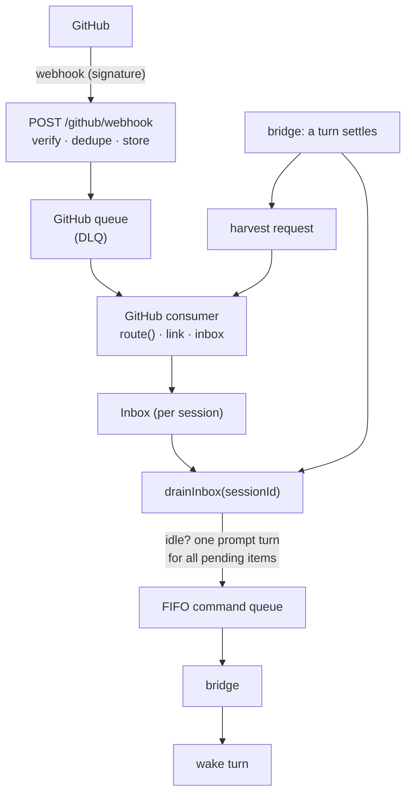

# GitHub wake: pull request activity starts a new turn

When a Kiro cloud session opens a pull request and then waits (usually for
you), GitHub activity on that PR can wake the session with a new turn: the PR
was merged or closed, changes were requested, you commented, or checks failed.
The agent then continues the work, or wraps up.

The feature is **optional and off by default**. Without `GITHUB_APP_SECRET_ARN`
nothing is deployed for it: no webhook route, queues, functions or schedule.

kiro-remote never opens PRs itself. Kiro's agent does, through Kiro's own GitHub
app. kiro-remote only does two things:

1. **Link** the PR to the session that opened it.
2. **Turn GitHub events into prompts**, at a time the session can accept them.

## How it works



- **Webhook ingress** (`packages/github/src/ingress.ts`) verifies
  `X-Hub-Signature-256` over the raw body with a constant-time compare, drops
  repos outside `ALLOWED_REPOS`, claims the delivery id (`GHDLV#<id>`, 7 day
  TTL), stores the raw delivery (an S3 pointer above 64 KB), enqueues its id and
  returns 202. A duplicate delivery is a no-op 202.
- **Consumer** (`packages/github/src/consumer.ts`) turns a stored delivery into
  actions with one pure function, `route(event, links, config)`, and applies
  them.
- **Inbox**: wake items are typed rows per session (`SESSION#<id>` /
  `INBOX#<ulid>`). GitHub is the first producer; scheduled launches, issue
  assignment or Slack can write the same rows later.
- **`drainInbox(sessionId)`** (`packages/core/src/service/inbox.ts`) is the
  only code that turns inbox items into a turn. A cloud session rejects a
  mid-turn steer and `whenBusy=queue`
  ([details](./deploy.md#operations-cloud-sessions-do-not-support)), so a wake
  **never** goes into a busy session: it waits as `pending`. The drain runs
  from the consumer (when the session is idle) and from the bridge **every time
  a turn settles** (live, failed, or a catch-up finishing), through one helper
  (`packages/bridge/src/settle.ts`).
- A drain takes all due pending items, oldest first, folds them into **one**
  prompt turn and marks them `delivered` with the turn id. It takes an
  optimistic lock on the session's META row, and `sendPrompt` bumps the same
  version, so a manual prompt that lands first wins and the drain runs again
  after that turn. Items for a `failed` or `deleted` session are dropped, with
  the reason recorded (`dropReason`).
- A wake turn is launch-class: if you already have `MAX_CLOUD_SESSIONS` (10)
  _other_ sessions running, the items stay pending and the next drain retries.

## Linking a PR to a session

A PR links to **at most one** session; a conflicting second link is refused and
never overwrites. There is **no matching on branch names or titles**, ever.

| Method    | When                                                                                                                                                                                            |
| --------- | ----------------------------------------------------------------------------------------------------------------------------------------------------------------------------------------------- |
| `harvest` | After each turn settles, the consumer scans that turn's `tool.call`, `tool.update` and `message.chunk` events for `https://github.com/<owner>/<repo>/pull/<n>`.                                 |
| `trailer` | The launch prompt asks the agent to put `Kiro-Remote-Session: <sessionId>` in the PR body; `pull_request.opened`/`edited` parse it.                                                             |
| `manual`  | `POST /v1/sessions/{id}/links`, `kiro_link_pull_request`. Remove with `DELETE /v1/sessions/{id}/links/{owner}/{repo}/{n}`, `kiro_unlink_pull_request`. `GET /v1/sessions/{id}` lists `links[]`. |

A harvested URL becomes a link only if **all** of these hold. Each rejected
candidate is recorded on the session as a `session.info` event
(`rawType: "pr_link_rejected"`, with `reason`):

- `repo_not_in_session`: owner/repo is in the session's `repos[]`
- `pr_not_found`: the PR exists (read with an installation token)
- `created_before_session`: the PR was created after the session was
- `already_linked`: it is not linked to another session

A trailer is accepted only if the named session exists and is not deleted, the PR's
repo is in its `repos[]`, the PR was created after the session, and (when
`GITHUB_AGENT_LOGINS` is set) the PR is authored by the agent. A forged trailer
fails one of these and is logged (`trailer_rejected`) and counted, never linked.

A delivery for an unlinked PR is stored as **unmatched**. `GET
/v1/github/unmatched?limit=20` (`sessions:read`) lists the recent ones for repos
matching `ALLOWED_REPOS`, so you can link them by hand.

> **Which method links in practice.** In the live run, the PR URL was in the
> event log and `harvest` linked the PR about 5 s after it was opened; the agent
> also wrote the trailer. See [the audit](#the-link-method-audit). Both methods
> stay on, and the trailer is **on by default** (`GITHUB_PR_TRAILER=on`). To
> turn it off set `GITHUB_PR_TRAILER=off`; the launch prompt then gets no extra
> line.

## What wakes a session

Every wake prompt starts with one fixed header line, so the agent and the
transcript know why the turn started:

```text
[GitHub webhook] This turn was started by GitHub, not by the user: <event> on <owner>/<repo>#<n> (delivery <id>).
```

| Event                                                                                              | Wake                                                                                                                                                                        |
| -------------------------------------------------------------------------------------------------- | --------------------------------------------------------------------------------------------------------------------------------------------------------------------------- |
| `pull_request.closed`, merged                                                                      | "PR #n was merged into `<base>` at `<sha>`. Finish any remaining work and summarise what's left, or say you're done."                                                       |
| `pull_request.closed`, not merged                                                                  | "PR #n was closed without merging."                                                                                                                                         |
| `pull_request_review.submitted`: `changes_requested` or `commented`                                | Who and which state. A trusted reviewer's review body and inline comments are also quoted.                                                                                  |
| `issue_comment.created` on a linked PR                                                             | Who commented. A trusted commenter's text is quoted. Bots, the agent's logins and comments posted through the agent's app are ignored ([why](#the-agents-github-identity)). |
| `check_suite.completed` / `workflow_run.completed`, `failure` or `timed_out`, on the PR's head sha | The failing check names and URLs. **Debounced 2 minutes per PR**: one wake for the whole batch.                                                                             |
| everything else                                                                                    | No wake. The delivery is kept (7 days), and `pull_request.*` refreshes the link's `prState` and `headSha`.                                                                  |

**Untrusted text is never forwarded.** For anyone outside `GITHUB_TRUSTED_LOGINS`
(default: the owner of the repo the event is about, which is the App's
installation owner) the prompt states only the structured fact. Trusted text is
quoted as data between `<<<BEGIN GITHUB QUOTE>>>` and `<<<END GITHUB QUOTE>>>`,
capped at 8,000 characters in total, with the markers stripped from the text. Check
names are shown as one bounded line each, because workflow names are written by
whoever can push.

`autoCloseOnMerge` (`GITHUB_AUTO_CLOSE_ON_MERGE`, `off` or `after_turn`,
default `off`): after the post-merge turn **completes**, the session is deleted
to free a slot. Never on closed-unmerged, and not if that turn failed.

The decision waits for that turn's harvest, and the session is **kept** when any
of its linked PRs is still open (or still `unknown`, as a manual link starts).
A session that opens a follow-up PR in its post-merge turn therefore stays alive
to see that PR through; without this it would be deleted and the second PR's
merge could never reach it. A kept session is logged as `auto_close_skipped`
with the open PRs.

### The agent's GitHub identity

Seen in the live run: Kiro's agent opens PRs as **`kiro-agent[bot]`**, but
posts PR comments **as you**, through the `kiro-agent` GitHub App. Such a
comment arrives with your login, so by login alone it looks like a trusted
comment from you; the only mark is `performed_via_github_app.slug:
"kiro-agent"`. Before this was handled, the agent's own reply comment woke its
session again, and an agent that comments in every turn would keep waking
itself.

So a comment posted through the `kiro-agent` app never wakes a session, whoever
it is attributed to. The same check is applied to reviews, though GitHub's REST
review objects do not carry the field, so an agent review posted as you would
still wake the session (the agent has not been seen reviewing). Set
`GITHUB_AGENT_LOGINS=kiro-agent[bot]` so the trailer link also requires the PR
to be authored by the agent. Do **not** put your own login there: that would
ignore your comments.

## Registering the GitHub App

You register a **private** GitHub App on your own account, by hand. The App only
**reads**: it has no write permission anywhere.

1. GitHub → your profile picture → **Settings** → **Developer settings** →
   **GitHub Apps** → **New GitHub App**.
2. **GitHub App name**: for example `kiro-remote-<your-login>` (unique on GitHub,
   at most 34 characters).
3. **Homepage URL**: `https://github.com/nikovirtala/kiro-remote` (any URL).
4. **Callback URL**, **Setup URL**: leave empty. No user tokens are used, so leave
   **Request user authorization (OAuth) during installation** and **Enable Device
   Flow** unticked.
5. **Webhook**: tick **Active**.
   - **Webhook URL**: `https://<host>/github/webhook` (the `PUBLIC_BASE_URL` of
     your stack).
   - **Webhook secret**: a long random string. Generate one with
     `openssl rand -hex 32` and keep it for the secret below.
   - **SSL verification**: **Enable SSL verification**.
6. **Repository permissions**: set exactly these to **Read-only**, and leave
   every other permission at **No access**:
   - **Metadata**: Read-only (mandatory, GitHub sets it)
   - **Pull requests**: Read-only
   - **Issues**: Read-only
   - **Checks**: Read-only
   - **Actions**: Read-only

   Account and organization permissions: **No access**.
7. **Subscribe to events**: tick exactly `Pull request`, `Pull request review`,
   `Issue comment`, `Check suite`, `Workflow run`.
8. **Where can this GitHub App be installed?**: **Only on this account**.
9. **Create GitHub App**.
10. On the App's page, note the **App ID**, then **Generate a private key**. A
    `.pem` file downloads.
11. **Install App** (left sidebar) → your account → **Only select repositories**,
    and pick only the repositories that match your `ALLOWED_REPOS`. Events from
    other repos are dropped at the webhook, but do not install it there.

> Why Pull requests, Issues, Checks and Actions? `pull_request` and
> `pull_request_review` need _Pull requests_; `issue_comment` is delivered under
> _Issues_ or _Pull requests_; `check_suite` needs _Checks_; `workflow_run` needs
> _Actions_. They are all read-only, so the App cannot change anything.

### The secret

Create one Secrets Manager secret in the stack's region and account, with this
JSON (the key is the whole PEM; newlines may be real or `\n`):

```bash
aws secretsmanager create-secret \
  --region "$AWS_REGION" --name kiro-remote/github-app \
  --secret-string "$(jq -n \
      --arg appId '<App ID>' \
      --arg privateKey "$(cat path/to/app.private-key.pem)" \
      --arg webhookSecret '<the webhook secret from step 5>' \
      '{appId: $appId, privateKey: $privateKey, webhookSecret: $webhookSecret}')"
```

Then set the full ARN in `deploy.env` and redeploy:

```bash
GITHUB_APP_SECRET_ARN=arn:aws:secretsmanager:<region>:<account>:secret:kiro-remote/github-app-AbCdEf
# optional:
GITHUB_TRUSTED_LOGINS=your-login          # default: the repo owner
GITHUB_AGENT_LOGINS=kiro-agent[bot]       # the login Kiro's agent opens PRs as
GITHUB_PR_TRAILER=on                      # on (default) | off
GITHUB_AUTO_CLOSE_ON_MERGE=off            # off (default) | after_turn
```

Only the webhook function and the consumer function can read the secret. The
bridge, the API and the OAuth functions cannot.

Installation tokens are minted on demand from the App's JWT by
`@octokit/auth-app` (no hand-rolled JWTs), cached in memory until 5 minutes
before they expire, and never logged. A rotated secret is picked up within
5 minutes.

After the deploy, GitHub's App page → **Advanced** → **Recent Deliveries** shows
the ping and every later delivery. A `202` is a good response.

## Missed deliveries

GitHub does not retry failed webhook deliveries. Every 15 minutes the consumer
lists the App's recent deliveries, picks those that failed and have not since
succeeded, and asks GitHub to redeliver up to 50
([handling failed deliveries](https://docs.github.com/en/webhooks/using-webhooks/handling-failed-webhook-deliveries)).
A redelivery keeps its `X-GitHub-Delivery` id, so dedupe still applies when it
arrives. A delivery the ingress stored but the consumer could not process goes to
the DLQ after 5 attempts and is not redelivered (its id is already claimed):
investigate the DLQ.

## Metrics

Namespace `KiroRemote/GitHub` (webhook, consumer): `WebhooksReceived`,
`WebhooksRejectedSignature`, `WebhooksDuplicate`, `WebhooksDropped`
(`reason=repo_not_allowed`), `WebhooksUnmatched`, `LinksCreated` (by `method`),
`LinksRejected` (by `reason`), `WakesDelivered`, `WakesDropped` (by `reason`),
`Redelivered`, `AutoClosed`, `AutoCloseSkipped` (a linked PR was still open). The bridge also emits `WakesDelivered` and `WakesDropped` as it
settles turns.

## Where it shows up

- `GET /v1/sessions/{id}`: `links[]` (`pr`, `linkedBy`, `prState`, `headSha`).
- `GET /v1/sessions/{id}/turns/{turnId}`: `trigger` (`{ source: "user" | "github", deliveryIds }`).
- `GET /v1/sessions/{id}/events`: a wake turn begins with a `session.info` event,
  `rawType: "turn_started"`, whose payload has the trigger.
- `kiro_get_transcript`: every turn has a `trigger`.

## The link-method audit

The question was where the PR URL appears in the event log, which decides
which link method is primary. The first two attempts, from another account,
could not create a PR (that session's GitHub connection could not see the
repo). The live e2e run on 2026-11-11 against a throwaway repo
(`nikovirtala/kiro-remote-e2e`, PR #1) answered it:

| Question                                  | Result                                                                                       |
| ----------------------------------------- | -------------------------------------------------------------------------------------------- |
| PR URL in the event log                   | Yes. `harvest` created the link 5 s after the PR was opened (`LinksCreated method=harvest`). |
| Agent writes the trailer                  | Yes: `Kiro-Remote-Session: <sessionId>` in the PR body.                                      |
| PR author                                 | `kiro-agent[bot]` (type `Bot`)                                                               |
| PR head branch                            | `docs/kiro-remote-e2e-<run id>`, as the prompt asked                                         |
| Author of the agent's PR comments         | **You**, through the `kiro-agent` app ([see above](#the-agents-github-identity))             |
| Review submitted to wake command enqueued | ~5 s                                                                                         |
| Merge to wake command enqueued            | ~10 s (the session was busy with another turn, so the item waited for it to settle)          |

The event shapes the extractor relies on, from the first recorded turns:

| Event type      | Field that carries command/URL text                                     |
| --------------- | ----------------------------------------------------------------------- |
| `tool.call`     | `payload.rawInput.command` (the command the agent runs)                 |
| `tool.update`   | `payload.rawOutput.output` (the command's output) and `payload.content` |
| `message.chunk` | `content.text`, in many small chunks (48 raw, 2 after coalescing)       |

So the extractor scans tool events whole and joins runs of adjacent
`message.chunk` events, because a URL can straddle a chunk boundary. The
recorded shape is in
[`packages/core/test/fixtures/audit-turn-no-pr.redacted.json`](../packages/core/test/fixtures/audit-turn-no-pr.redacted.json).
A fixture with a PR URL in each field is **synthetic**
(`pr-url-events.synthetic.json`) and is labelled as such.

## Live end-to-end scenario (opt-in)

Needs a deployed stack with the App installed on the e2e repo, `kiro-remote
login`, and the GitHub CLI logged in as a **trusted** login. Use a **throwaway
repo** that Kiro's GitHub connection can write to: the scenario squash-merges
the agent's PR, so every run adds a commit to its default branch.

```bash
KIRO_REMOTE_URL=https://<host> KIRO_API_E2E_REPO=<owner>/<name> \
KIRO_API_E2E_GITHUB=1 [KIRO_API_E2E_GITHUB_AUTOCLOSE=1] \
  pnpm e2e
```

Steps (after the normal ones): `gh-launch` (the agent opens a docs-only PR),
`gh-link` (the PR is linked; reports the method), `gh-review-wake` (posts a review
comment as the trusted login and waits for the wake turn; reports review-to-turn
latency), `gh-merge-wake` (merges the PR and waits for the post-merge wake turn;
with `KIRO_API_E2E_GITHUB_AUTOCLOSE=1`, also that the session is deleted), and
`gh-cleanup` (closes the PR, deletes its branch; the session is deleted by the
harness cleanup). After each wake turn settles, the step fails if **any**
other GitHub wake starts within 45 s: the harness did nothing that should cause
one, so it would be a self-wake (the review prompt asks for a reply, which the
agent may post as a PR comment) or something else waking the session, and the
next step could mistake it for its own. Each wake must also carry a delivery no
earlier step saw. Set `GITHUB_AUTO_CLOSE_ON_MERGE=after_turn` on the stack for the
auto-close check.

Then a second session runs a **chain** of two dependent PRs:
`gh-chain-launch` (the prompt asks for PR 1 now and PR 2 only after PR 1 is
merged, with PR 2 appending to the file PR 1 adds), `gh-chain-first-pr` (exactly
one PR was opened since the launch, and it is linked), `gh-chain-merge-first`
(merges PR 1 and waits for the wake turn; PR 2 must then be linked to the same
session, created after PR 1 was merged, and contain PR 1's merge commit),
`gh-chain-merge-second` (merges PR 2 and waits for its wake turn), and
`gh-chain-cleanup` (closes any open PR, deletes both branches). Both merge
steps apply the same 45 s quiet check.

A third session covers failing checks and a PR closed unmerged:
`gh-checks-launch` (the agent opens a PR whose only line is the marker
`KIRO_E2E_FAIL_CHECK`), `gh-checks-wake` (waits until the repo's check suite
actually fails on that PR's head commit, then for the debounced wake),
`gh-close-wake` (closes the PR unmerged and waits for that wake), and
`gh-checks-cleanup`. This needs a workflow in the **e2e repo's default branch**
that fails a pull request carrying the marker, for example:

```yaml
# .github/workflows/e2e-check.yml
name: e2e check
on: pull_request
permissions:
  contents: read
jobs:
  marker:
    runs-on: ubuntu-latest
    steps:
      - uses: actions/checkout@v5
      - run: |
          marker="KIRO_E2E""_FAIL_CHECK"
          if grep -rl --exclude-dir=.git --exclude-dir=.github "$marker" .; then
            exit 1
          fi
```

The launch prompt tells the agent not to fix the failure or push anything, so
the PR's head commit stays put and only the harness's own actions wake the
session.

## Out of scope (next steps)

Issue-driven launches ("label an issue `kiro` and a session starts"), GitLab,
write permissions for the App, posting status back to the PR, a web UI for links
and wake reasons.
