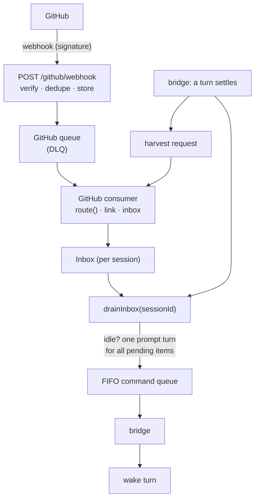
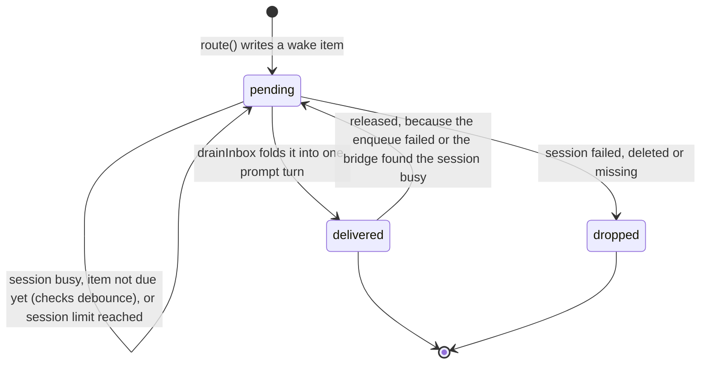
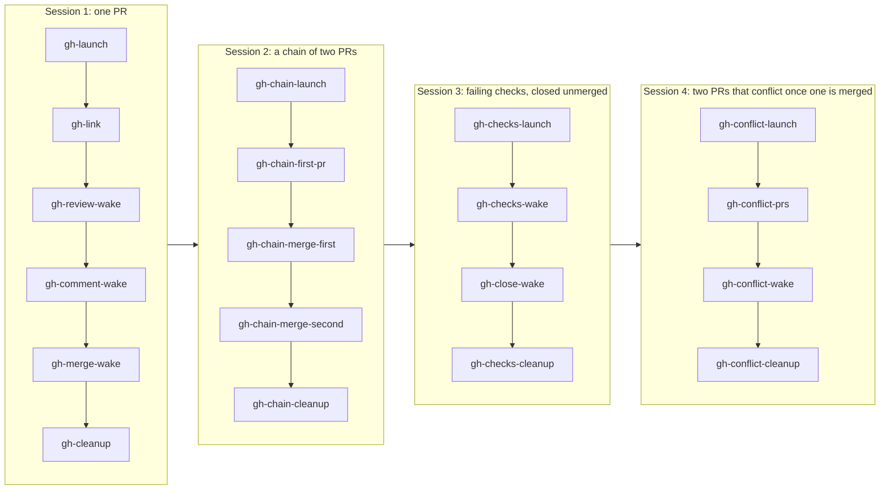

# GitHub wake: pull request activity starts a new turn

When a Kiro cloud session opens a pull request and then waits (usually for
you), GitHub activity on that PR can wake the session with a new turn: the PR
was merged or closed, changes were requested, you commented, or checks failed.
The agent then continues the work, or wraps up.

The feature is **optional and off by default**. Without `GITHUB_APP_SECRET_ARN`
nothing is deployed for it: no webhook route, queues, functions or schedule.

kiro-remote never opens PRs itself. Kiro's agent does, through Kiro's own GitHub
app. kiro-remote only does three things:

1. **Link** the PR to the session that opened it.
2. **Turn GitHub events into prompts**, at a time the session can accept them.
3. **Wake a session when a PR it waits for merges or closes**, though the session
   does not own that PR ([waiting for a pull request](#waiting-for-a-pull-request)).

## How it works



- **Webhook ingress** (`packages/github/src/ingress.ts`) verifies
  `X-Hub-Signature-256` over the raw body with a constant-time compare, drops
  repos outside `ALLOWED_REPOS`, claims the delivery id (`GHDLV#<id>`, 7 day
  TTL), stores the raw delivery (an S3 pointer above 64 KB), enqueues its id and
  returns 202. A duplicate delivery is a no-op 202.
- **Consumer** (`packages/github/src/consumer.ts`) turns a stored delivery into
  actions with one pure function, `route(event, links, config)`, and applies
  them.
- **Inbox**: wake items are typed rows per session (`SESSION#<id>` /
  `INBOX#<ulid>`). GitHub is the first producer; scheduled launches, issue
  assignment or Slack can write the same rows later.
- **`drainInbox(sessionId)`** (`packages/core/src/service/inbox.ts`) is the
  only code that turns inbox items into a turn. A cloud session rejects a
  mid-turn steer and `whenBusy=queue`
  ([details](./deploy.md#operations-cloud-sessions-do-not-support)), so a wake
  **never** goes into a busy session: it waits as `pending`. The drain runs
  from the consumer (when the session is idle) and from the bridge **every time
  a turn settles** (live, failed, or a catch-up finishing), through one helper
  (`packages/bridge/src/settle.ts`).
- A drain takes all due pending items, oldest first, folds them into **one**
  prompt turn and marks them `delivered` with the turn id. It takes an
  optimistic lock on the session's META row, and `sendPrompt` bumps the same
  version, so a manual prompt that lands first wins and the drain runs again
  after that turn. Items for a `failed` or `deleted` session are dropped, with
  the reason recorded (`dropReason`).
- A wake turn is launch-class: if you already have `MAX_CLOUD_SESSIONS` (10)
  _other_ sessions running, the items stay pending and the next drain retries.

An inbox item moves through three states:



## Linking a PR to a session

A PR links to **at most one** session; a conflicting second link is refused and
never overwrites. There is **no matching on branch names or titles**, ever.

| Method    | When                                                                                                                                                                                            |
| --------- | ----------------------------------------------------------------------------------------------------------------------------------------------------------------------------------------------- |
| `harvest` | After each turn settles, the consumer scans that turn's `tool.call`, `tool.update` and `message.chunk` events for `https://github.com/<owner>/<repo>/pull/<n>`.                                 |
| `trailer` | The launch prompt asks the agent to put `Kiro-Remote-Session: <sessionId>` in the PR body; `pull_request.opened`/`edited` parse it.                                                             |
| `manual`  | `POST /v1/sessions/{id}/links`, `kiro_link_pull_request`. Remove with `DELETE /v1/sessions/{id}/links/{owner}/{repo}/{n}`, `kiro_unlink_pull_request`. `GET /v1/sessions/{id}` lists `links[]`. |

A harvested URL becomes a link only if **all** of these hold. Each rejected
candidate is recorded on the session as a `session.info` event
(`rawType: "pr_link_rejected"`, with `reason`):

- `repo_not_in_session`: owner/repo is in the session's `repos[]`
- `pr_not_found`: the PR exists (read with an installation token)
- `created_before_session`: the PR was created after the session was
- `already_linked`: it is not linked to another session

A trailer is accepted only if the named session exists and is not deleted, the PR's
repo is in its `repos[]`, the PR was created after the session, and (when
`GITHUB_AGENT_LOGINS` is set) the PR is authored by the agent. A forged trailer
fails one of these and is logged (`trailer_rejected`) and counted, never linked.
`Kiro-Remote-Waits-For` lines in the same body are read under these same rules
(see [Waiting for a pull request](#waiting-for-a-pull-request)).

A delivery for an unlinked PR is stored as **unmatched**. `GET
/v1/github/unmatched?limit=20` (`sessions:read`) lists the recent ones for repos
matching `ALLOWED_REPOS`, so you can link them by hand.

> **Which method links in practice.** In the live run, the PR URL was in the
> event log and `harvest` linked the PR about 5 s after it was opened; the agent
> also wrote the trailer. See [the audit](#the-link-method-audit). Both methods
> stay on, and the trailer is **on by default** (`GITHUB_PR_TRAILER=on`). To
> turn it off set `GITHUB_PR_TRAILER=off`; the launch prompt then gets no extra
> line.

## What wakes a session

Every wake prompt starts with one fixed header line, so the agent and the
transcript know why the turn started:

```text
[GitHub webhook] This turn was started by GitHub, not by the user: <event> on <owner>/<repo>#<n> (delivery <id>).
```

| Event                                                                                                                 | Wake                                                                                                                                                                                                                                                                                                             |
| --------------------------------------------------------------------------------------------------------------------- | ---------------------------------------------------------------------------------------------------------------------------------------------------------------------------------------------------------------------------------------------------------------------------------------------------------------- |
| `pull_request.closed`, merged                                                                                         | "PR #n was merged into `<base>` at `<sha>`. Finish any remaining work and summarise what's left, or say you're done."                                                                                                                                                                                            |
| `pull_request.closed`, not merged                                                                                     | "PR #n was closed without merging."                                                                                                                                                                                                                                                                              |
| `pull_request.closed`, merged, on a PR a session **waits for**                                                        | "PR #m, which this session waits for, was merged into `<base>` at `<sha>`. Rebase onto `<base>` (never merge it in), continue the work it unblocked, push with --force-with-lease and say what changed." One per waiting session, linked or not. See [Waiting for a pull request](#waiting-for-a-pull-request).  |
| `pull_request.closed`, not merged, on a PR a session **waits for**                                                    | "PR #m, which this session waits for, was closed without merging. Say whether your work can go on without it."                                                                                                                                                                                                   |
| `pull_request_review.submitted`: `changes_requested` or `commented`                                                   | Who and which state. A trusted reviewer's review body and inline comments are also quoted.                                                                                                                                                                                                                       |
| `issue_comment.created` on a linked PR                                                                                | Who commented. A trusted commenter's text is quoted. Bots, the agent's logins and comments posted through the agent's app are ignored ([why](#the-agents-github-identity)).                                                                                                                                      |
| `check_suite.completed` / `workflow_run.completed`, `failure` or `timed_out`, on the PR's head sha                    | The failing check names and URLs. **Debounced 2 minutes per PR**: one wake for the whole batch.                                                                                                                                                                                                                  |
| a base branch moves (a PR merged into it, or a push to it), and a linked open PR on it now conflicts                  | "PR #n no longer merges into `<base>`: it conflicts with `<base>` at `<sha>` (after #m was merged / after a push). Rebase onto `<base>` (never merge it in), resolve the conflicts, push with --force-with-lease and say what changed." **Debounced 2 minutes per PR.** See [Conflicting PRs](#conflicting-prs). |
| the same check, with `GITHUB_WAKE_ON_BEHIND=on`: the PR merges but is behind a base that requires up-to-date branches | "PR #n is behind `<base>`, which requires it to be up to date before merging: `<base>` moved to `<sha>` (after #m was merged / after a push). Rebase onto `<base>` (never merge it in), push with --force-with-lease and say what changed." **Off by default.** Debounced like a conflict.                       |
| everything else                                                                                                       | No wake. The delivery is kept (7 days), and `pull_request.*` refreshes the link's `prState` and `headSha`.                                                                                                                                                                                                       |

**Untrusted text is never forwarded.** For anyone outside `GITHUB_TRUSTED_LOGINS`
(default: the owner of the repo the event is about, which is the App's
installation owner) the prompt states only the structured fact. Trusted text is
quoted as data between `<<<BEGIN GITHUB QUOTE>>>` and `<<<END GITHUB QUOTE>>>`,
capped at 8,000 characters in total, with the markers stripped from the text. Check
names are shown as one bounded line each, because workflow names are written by
whoever can push.

`autoCloseOnMerge` (`GITHUB_AUTO_CLOSE_ON_MERGE`, `off` or `after_turn`,
default `off`): after the post-merge turn **completes**, the session is deleted
to free a slot. Never on closed-unmerged, and not if that turn failed.

The decision waits for that turn's harvest, and the session is **kept** when any
of its linked PRs is still open (or still `unknown`, as a manual link starts).
A session that opens a follow-up PR in its post-merge turn therefore stays alive
to see that PR through; without this it would be deleted and the second PR's
merge could never reach it. A kept session is logged as `auto_close_skipped`
with the open PRs.

### Conflicting PRs

GitHub sends **no webhook when a pull request becomes conflicting**: mergeability
is computed lazily and a change is not announced, and a conflicting PR gets no CI
run, so the failing-checks wake cannot catch it either. What does change is the
PR's **base branch**, so that is what the check watches.

1. **A base branch moves.** `route()` turns two events into a `checkBase` action:
   `pull_request.closed` with `merged` (the base is `pull_request.base.ref`, the
   new tip `merge_commit_sha`), whether or not the merged PR is linked, and
   `push` to a branch (the new tip is `after`; deleted branches and tags are
   ignored). A later trigger, for example a scheduled sweep, builds the same
   `BaseMove` and reuses the check.
2. **Candidates.** The consumer lists the **open** linked PRs of that repo with
   one GSI1 query (`GHREPO#<owner>/<repo>`, sort key `OPEN#<n>`). It skips the
   PR that was just merged and any PR whose stored `baseRef` is another branch,
   without reading GitHub. A link with no stored `baseRef` is read and filtered
   by what GitHub reports.
3. **Read and decide.** For each candidate it reads `GET /pulls/{n}` and calls
   the pure `decideConflict()` (`packages/github/src/conflicts.ts`). The result
   is a small state: `clean`, `behind`, `conflicting` or `unknown`. `conflicting`
   (`mergeable: false`, or `mergeable_state: "dirty"`) writes a wake. `behind`
   (mergeable, but out of date with a base that requires up-to-date branches)
   writes a wake only with `GITHUB_WAKE_ON_BEHIND=on`; otherwise it is logged and
   wakes nothing. See [Behind but mergeable](#behind-but-mergeable).
4. **GitHub has not computed it yet.** Right after the base moved, a read
   returns `mergeable: null` and starts a background job
   ([REST docs](https://docs.github.com/en/rest/pulls/pulls#get-a-pull-request)).
   The check never guesses from `null`. It sends a delayed `conflict_check`
   message on the GitHub queue (SQS `DelaySeconds`) and asks again:
   **3 tries at 0 s, 40 s and 120 s**, then it gives up and records why
   (`ConflictChecksGaveUp`, `reason=still_unknown`; a GitHub read that keeps
   failing gives up with `reason=read_failed`). A delayed message needs no
   schedule or new table, survives a Lambda restart, and a failed try is retried
   by SQS itself.
5. **Never wake for** the PR that was just merged, a closed or merged PR, a PR on
   another base, or a PR whose **head changed** after the first try. A newer head
   means the agent may already have rebased, so the re-check compares the head sha
   it saw first with the current one and skips on a difference.
6. **Debounce.** The wake is a `pr_conflict` inbox item with key `owner/repo#n`,
   debounced 2 minutes like failing checks: several merges in a row (or a merge
   and its own `push` delivery) fold into one item that lists every merged PR and
   the latest base sha. As for every wake, a busy session keeps the item pending
   until its turn settles.

The check costs **one read of `GET /pulls/{n}` per linked open PR per base move**
(plus up to two re-reads while GitHub computes), and one GSI1 query. The App's
**Pull requests: Read-only** permission covers it; nothing is written to GitHub.

| `mergeable` | `mergeable_state`                   | State         | Wakes                                |
| ----------- | ----------------------------------- | ------------- | ------------------------------------ |
| `false`     | `dirty` (or any)                    | `conflicting` | yes                                  |
| `null`      | any                                 | `unknown`     | no: ask again, at most 3 tries       |
| `true`      | `behind`                            | `behind`      | only with `GITHUB_WAKE_ON_BEHIND=on` |
| `true`      | `clean`, `blocked`, `unstable`, ... | `clean`       | no                                   |

**The `push` subscription is optional.** Without it only a merged PR moves a base
(the common case today), and everything above works as described. With it, a
direct push to a base branch (or a force push) also triggers the check. It needs
the **Push** event and **Contents: Read-only**; see
[Registering the GitHub App](#registering-the-github-app). Every push to any
branch of an allowed repo is then delivered and stored (7 days), and one that
targets no linked PR's base costs one GSI1 query. A merge then arrives as both
`pull_request.closed` and `push`; the wake is debounced into one, but the PRs are
read twice.

#### Behind but mergeable

`GITHUB_WAKE_ON_BEHIND` (`off` or `on`, default `off`): with `on`, the same check
also wakes a session whose linked PR still merges but is `behind` its base, with
its own prompt asking for a rebase. GitHub reports `mergeable_state: "behind"`
when the base branch requires branches to be up to date before merging (the
"Require branches to be up to date before merging" option of a status-check
rule, or the strict policy of a ruleset). Without that rule a PR that is behind
but merges cleanly is reported `clean`, so the setting wakes only where the
rebase is needed to merge.

In such a repo every merge leaves every other open PR on that base behind, so
with `on` each merge wakes every session with an open linked PR there. Each
wake is a launch-class turn and counts toward `MAX_CLOUD_SESSIONS`. It needs no
new App permission (`mergeable_state` comes from the same `GET /pulls/{n}` read)
and adds no reads.

A conflict and a behind wake for the same PR never both go out, since both ask
for a rebase. A pending conflict wake absorbs a behind result, and a conflict
replaces a pending behind wake (`WakesDropped`, `reason=superseded_by_conflict`)
and keeps the PRs it named.

**Links made before this feature** join the index the next time a
`pull_request` webhook for them is processed (any push to the PR, an edit, a
label). Until then a merge does not check them.

## Waiting for a pull request

A session is woken by its own linked PR. It is not woken by a PR it merely
**depends on**: a stacked PR it must rebase onto, or another repo's change it
needs. A **wait** says "wake me once when that PR merges or closes". A session can
wait for any number of PRs, and a PR can be waited for by any number of sessions.
A wait is **not a link**: the PR may belong to another session or to none, and it
may be in a repo the session does not use (a draft session can wait for an ark PR).
Its repo only has to match `ALLOWED_REPOS`.

| Method    | How                                                                                                                                                                                                       |
| --------- | --------------------------------------------------------------------------------------------------------------------------------------------------------------------------------------------------------- |
| `mcp`     | `kiro_wait_for_pull_request { sessionId, pr }`; remove with `kiro_stop_waiting_for_pull_request`. Both take `idempotencyKey`.                                                                             |
| `rest`    | `POST /v1/sessions/{id}/waits { pr }`; remove with `DELETE /v1/sessions/{id}/waits/{owner}/{repo}/{n}`. `sessions:write`, the scope of linking.                                                           |
| `trailer` | A linked PR's body carries one `Kiro-Remote-Waits-For: owner/repo#n` line per awaited PR. The launch prompt line that asks for `Kiro-Remote-Session` asks for these too (when `GITHUB_PR_TRAILER` is on). |

`GET /v1/sessions/{id}` and `kiro_get_session` list the session's `waits[]` (`pr`,
`repo`, `number`, `source`, `createdAt`).

**What is stored.** One item per wait: `SESSION#<id>` / `WAIT#<owner>/<repo>#<n>`
with the source (`mcp`, `rest` or `trailer`) and the time, and
`GSI1PK = GHWAIT#<owner>/<repo>#<n>`, `GSI1SK = <session id>`. The session's key
answers "what does this session wait for", GSI1 answers "who waits for this PR",
and each is one query. One item means one conditional write, with no second row
to keep in step. The source is a field of the wait, not of a link, so a later
producer (an ark issue's depends-on link, a map in draft) adds a value to
`source` and uses the same two queries.

**Registering.** The call stores the wait with `attribute_not_exists`, so
registering twice is a no-op (`200`, the first source stays), then sends a
`wait_check` message on the GitHub queue. The API holds no GitHub credentials, so
the GitHub consumer reads the PR once: **merged or closed fires the wait now,
open leaves it stored** for the webhook. The wait is stored first and read
second, so a PR that merges between the two is still found. A PR the App cannot
read (a typo, or a repo it is not installed on) removes the wait and wakes the
session once with "could not be read from GitHub", rather than waiting forever.
Without the GitHub feature the calls answer `501`.

**A trailer** is read where `Kiro-Remote-Session` is read (`pull_request.opened`
and `edited`, in `linkFromTrailer`), and counts only when that trailer is
accepted, under the same rules (session exists and is not deleted, the PR's repo
is in its `repos[]`, the PR is newer than the session, author is the agent when
`GITHUB_AGENT_LOGINS` is set). A PR already linked to the same session is read
again only when it carries waits lines, so an edit can add them. Each awaited repo
must match `ALLOWED_REPOS`. A malformed line, a line not at the start of a line, a
PR waiting for itself and anything past 20 lines are ignored; refusals are logged
(`wait_rejected`) and counted (`WaitsRejected`, by `reason`).

**The wake.** `route()` turns `pull_request.closed` into one wake per waiting
session, whether or not the PR is linked to anyone, using the pure
`decideWait()` (`packages/github/src/waits.ts`). The webhook and the check above
both call it, and so can a later scheduled sweep for waits whose PR merged while
webhooks were down. Only structured facts are forwarded, never the PR's text.

```text
[GitHub webhook] This turn was started by GitHub, not by the user: pull_request.closed (merged), awaited by this session on octo/repo#7 (delivery <id>).
PR #7, which this session waits for, was merged into main at <sha>. Rebase onto main (never merge it in), continue the work it unblocked, push with --force-with-lease and say what changed.
```

```text
[GitHub webhook] This turn was started by GitHub, not by the user: pull_request.closed (not merged), awaited by this session on octo/repo#7 (delivery <id>).
PR #7, which this session waits for, was closed without merging. Say whether your work can go on without it.
```

When the check made at registration finds the PR already closed, the header has
no delivery (`... was already merged when the wait was checked on octo/repo#7.`).

**A fired wait is removed**, and the removal is the claim: of a webhook and a check
that fire it at the same moment, only the transaction that deletes it commits, and it writes the
wake in the same transaction. If the wake cannot be written the wait stays where it was and the message is retried.

**One turn for a wait and the waiter's own conflict.** The drain folds all _due_
inbox items of a session into one turn, so the two wakes only share a turn when
both are due at the drain. A merge can make the waiter's own open PR in the same
repo conflict, and that check takes a 2 minute debounce plus up to two re-checks
(see [Conflicting PRs](#conflicting-prs)). For such a waiter (an open linked PR in
the merged PR's repo, on the same base or one not yet known) the merge wake is
**held** for the debounce, all re-check delays and 30 s, about 4.5 minutes, and a
conflict wake is never due before a pending wait wake: whichever is written second
moves the other's due time. They then fold into one turn, the conflict first. A
waiter with no such PR, and every closed-unmerged wake, goes out at once.

Waits need **no new GitHub App permission or event**: `pull_request.closed` is
already delivered, and the read is `GET /pulls/{n}`. They cost one GSI1 query per
`pull_request.closed` delivery (and one `queryLinks` per waiter of a merged PR),
and one read per registered wait. The API function gains
`GITHUB_QUEUE_URL` and permission to send to the GitHub queue.

## The change feed

kiro-remote decides from its own state: which PR belongs to which session, what a
session waits for, which session to wake and why. It **publishes each of those
decisions as an event**, so that other readers (draft's map, ark's folds) can show
what a session waits for and why it woke without a second copy of the state. This
is ark ADR 9t6n5jc6 ("Publish every decision a system makes as events others can
read"): the rule is "no state that only one reader can see".

**One feed per account**, the owner of the session an event is about, append-only
and ordered. Read it with a cursor:

- `GET /v1/events?after=<cursor>&limit=<n>` and the tool `kiro_list_events`
  `{ after, limit }`. `after` is the `seq` of the last event you read (`0` to start);
  `limit` defaults to 50, at most 200. The answer is
  `{ events, nextCursor, hasMore }`; pass `nextCursor` as `after` to continue, and
  stop when `hasMore` is false. With nothing new, `nextCursor` is the `after` you sent.
- It needs `sessions:read` and returns your events only. Events are filed under the
  owner of their session, so another account's events are in another partition,
  not hidden by a filter.

**An event:**

```json
{
  "v": 1,
  "id": "01M8...",
  "seq": 2,
  "ts": "2026-11-24T08:01:12.000Z",
  "type": "wait.removed",
  "effect": "state",
  "sessionId": "01M8...",
  "pr": "octo/repo#7",
  "source": "webhook",
  "payload": { "reason": "merged" }
}
```

| Type                 | Effect       | When, and the payload                                                                                                                                                                         |
| -------------------- | ------------ | --------------------------------------------------------------------------------------------------------------------------------------------------------------------------------------------- |
| `link.added`         | `state`      | A PR was linked. `{ method: harvest\|trailer\|manual, prState }`.                                                                                                                             |
| `link.removed`       | `state`      | A link was removed. `{ reason: "unlinked" }`.                                                                                                                                                 |
| `link.state_changed` | `state`      | The linked PR opened, closed or merged. `{ from, to }`. A refresh of the head or base alone writes no event.                                                                                  |
| `wait.registered`    | `state`      | A session started waiting for a PR. `{ waitSource: mcp\|rest\|trailer }`.                                                                                                                     |
| `wait.removed`       | `state`      | A wait ended. `{ reason }`: `merged`, `closed`, `unreadable` (it **fired**), `stopped` (the caller removed it) or `registration_failed` (stored, but its first check could not be requested). |
| `wake.queued`        | `annotation` | A wake was written to the session's inbox, or folded into a pending one (`merged: true`). `{ itemId, kind, cause, merged }`.                                                                  |
| `wake.delivered`     | `annotation` | The wake was sent to the session as a prompt turn. `{ itemId, kind, cause, turnId }`.                                                                                                         |
| `wake.released`      | `annotation` | The turn did not start, the wake is pending again. Same payload as delivered.                                                                                                                 |
| `wake.dropped`       | `annotation` | The wake was not sent (session failed or deleted, auto-closed). `{ itemId, kind, cause, reason }`.                                                                                            |

`cause` is why the session was woken: `linked_pr_event` (its own PR merged, closed,
was reviewed or commented on, or failed checks), `conflict` (its PR no longer merges
or is behind) or `wait` (a PR it waits for closed). `kind` is the wake's own name
(`pr_merged`, `pr_conflict`, `pr_wait_merged`, ...). A fired wait is two events in one
commit, `wait.removed` and the `wake.queued` it caused.

`source` is who caused the change: `mcp` or `rest` (a caller), `trailer` (a
`Kiro-Remote-*` line in a PR body), `webhook` (a GitHub delivery and the delayed
re-checks it started), `harvest` (the PR URL the agent printed in a turn) or `sweep`
(a read of GitHub kiro-remote made on its own initiative: the check made when a wait
is registered, and any later scheduled sweep). A reader treats an unknown `source` as
opaque.

**Never in an event:** prompt text, transcript content, PR titles or bodies, tokens.
Only ids, PR references, enums and counts.

**Atomic with the change.** An event is written in the same DynamoDB transaction
(`TransactWriteItems`) as the state change it records, so a change cannot exist without
its event or the other way round. `packages/core/src/repo/feed.ts` numbers the events:
a transaction reads the account's counter and writes `seq = last + 1` guarded by the
value it read, together with the change and the events. Two writers that read the same
counter cannot both commit, the second is cancelled and reads again, so commits are
serialised in `seq` order. **`seq` has no gaps** and an event with a lower `seq` is
never committed after a higher one: a reader that holds a cursor cannot miss an event,
and a jump in `seq` means the events in between have expired. A test
(`feedViolations()` over the commands of every write path, in the unit and emulator
tests) fails when a link or a wait changes without an event.

**The contract is versioned.** The zod objects in
[`packages/core/src/schemas/feed.ts`](../packages/core/src/schemas/feed.ts) are
the source of truth. The JSON Schemas generated from them are checked in under
[`packages/core/schemas/feed/`](../packages/core/schemas/feed/): `envelope.json`,
`page.json` and one file per type (`pnpm --filter @nikovirtala/kiro-remote-core
gen:feed-schemas`, then `pnpm lint:fix`). A test fails when they drift from the code
and when an emitted event does not validate against them. A change that only adds an
optional payload field or a type stays in `v: 1`; anything else is `v: 2`.

**Skipping what you do not know.** `effect` says whether an event moves state a reader
follows (`state`: a link or a wait) or only records a decision (`annotation`: a wake).
A reader that meets a type it does not know may **skip it when it is an annotation**
and must **stop when it is `state`**, since the state it rebuilds would be wrong
(`feedEventDisposition()` does this). Readers ignore fields they do not know.

**Retention.** Events are kept **35 days** (DynamoDB TTL): at least 30, with 5 days of
margin for a reader that comes back about monthly. DynamoDB deletes late, never early. A reader that is away longer finds a jump in `seq` after its cursor.

**Where the feed starts.** Links and waits that exist before the feed was deployed have
no event, so a fold takes its starting state from `GET /v1/sessions/{id}`
(`links[]`, `waits[]`) and follows the feed from there, and says which cursor its view
was built from. The one thing the feed does not publish is the due time of a pending
wake being moved (a wait wake and a conflict wake are held to the same time), which is
not a decision to wake.

### The agent's GitHub identity

Seen in the live run: Kiro's agent opens PRs as **`kiro-agent[bot]`**, but
posts PR comments **as you**, through the `kiro-agent` GitHub App. Such a
comment arrives with your login, so by login alone it looks like a trusted
comment from you; the only mark is `performed_via_github_app.slug:
"kiro-agent"`. Before this was handled, the agent's own reply comment woke its
session again, and an agent that comments in every turn would keep waking
itself.

So a comment posted through the `kiro-agent` app never wakes a session, whoever
it is attributed to. The same check is applied to reviews, though GitHub's REST
review objects do not carry the field, so an agent review posted as you would
still wake the session (the agent has not been seen reviewing). Set
`GITHUB_AGENT_LOGINS=kiro-agent[bot]` so the trailer link also requires the PR
to be authored by the agent. Do **not** put your own login there: that would
ignore your comments.

## Registering the GitHub App

You register a **private** GitHub App on your own account, by hand. The App only
**reads**: it has no write permission anywhere.

1. GitHub → your profile picture → **Settings** → **Developer settings** →
   **GitHub Apps** → **New GitHub App**.
2. **GitHub App name**: for example `kiro-remote-<your-login>` (unique on GitHub,
   at most 34 characters).
3. **Homepage URL**: `https://github.com/nikovirtala/kiro-remote` (any URL).
4. **Callback URL**, **Setup URL**: leave empty. No user tokens are used, so leave
   **Request user authorization (OAuth) during installation** and **Enable Device
   Flow** unticked.
5. **Webhook**: tick **Active**.
   - **Webhook URL**: `https://<host>/github/webhook` (the `PUBLIC_BASE_URL` of
     your stack).
   - **Webhook secret**: a long random string. Generate one with
     `openssl rand -hex 32` and keep it for the secret below.
   - **SSL verification**: **Enable SSL verification**.
6. **Repository permissions**: set exactly these to **Read-only**, and leave
   every other permission at **No access**:
   - **Metadata**: Read-only (mandatory, GitHub sets it)
   - **Pull requests**: Read-only
   - **Issues**: Read-only
   - **Checks**: Read-only
   - **Actions**: Read-only

   Account and organization permissions: **No access**.
7. **Subscribe to events**: tick exactly `Pull request`, `Pull request review`,
   `Issue comment`, `Check suite`, `Workflow run`.
   - **Optional: `Push`.** Also tick `Push` (and set **Contents: Read-only** in
     step 6) to wake a session when a direct push, not a merge, makes its PR
     conflict ([Conflicting PRs](#conflicting-prs)). It is not needed for
     merges. An App that already exists needs **both** changes in its settings
     (Permissions & events), and GitHub asks each installation to accept the new
     permission.
8. **Where can this GitHub App be installed?**: **Only on this account**.
9. **Create GitHub App**.
10. On the App's page, note the **App ID**, then **Generate a private key**. A
    `.pem` file downloads.
11. **Install App** (left sidebar) → your account → **Only select repositories**,
    and pick only the repositories that match your `ALLOWED_REPOS`. Events from
    other repos are dropped at the webhook, but do not install it there.

> Why Pull requests, Issues, Checks and Actions? `pull_request` and
> `pull_request_review` need _Pull requests_; `issue_comment` is delivered under
> _Issues_ or _Pull requests_; `check_suite` needs _Checks_; `workflow_run` needs
> _Actions_; the optional `push` event needs _Contents_. They are all read-only, so the App cannot change anything.

### The secret

Create one Secrets Manager secret in the stack's region and account, with this
JSON (the key is the whole PEM; newlines may be real or `\n`):

```bash
aws secretsmanager create-secret \
  --region "$AWS_REGION" --name kiro-remote/github-app \
  --secret-string "$(jq -n \
      --arg appId '<App ID>' \
      --arg privateKey "$(cat path/to/app.private-key.pem)" \
      --arg webhookSecret '<the webhook secret from step 5>' \
      '{appId: $appId, privateKey: $privateKey, webhookSecret: $webhookSecret}')"
```

Then set the full ARN in `deploy.env` and redeploy:

```bash
GITHUB_APP_SECRET_ARN=arn:aws:secretsmanager:<region>:<account>:secret:kiro-remote/github-app-AbCdEf
# optional:
GITHUB_TRUSTED_LOGINS=your-login          # default: the repo owner
GITHUB_AGENT_LOGINS=kiro-agent[bot]       # the login Kiro's agent opens PRs as
GITHUB_PR_TRAILER=on                      # on (default) | off
GITHUB_AUTO_CLOSE_ON_MERGE=off            # off (default) | after_turn
GITHUB_WAKE_ON_BEHIND=off                 # off (default) | on
```

Only the webhook function and the consumer function can read the secret. The
bridge, the API and the OAuth functions cannot.

Installation tokens are minted on demand from the App's JWT by
`@octokit/auth-app` (no hand-rolled JWTs), cached in memory until 5 minutes
before they expire, and never logged. A rotated secret is picked up within
5 minutes.

After the deploy, GitHub's App page → **Advanced** → **Recent Deliveries** shows
the ping and every later delivery. A `202` is a good response.

## Missed deliveries

GitHub does not retry failed webhook deliveries. Every 15 minutes the consumer
lists the App's recent deliveries, picks those that failed and have not since
succeeded, and asks GitHub to redeliver up to 50
([handling failed deliveries](https://docs.github.com/en/webhooks/using-webhooks/handling-failed-webhook-deliveries)).
A redelivery keeps its `X-GitHub-Delivery` id, so dedupe still applies when it
arrives. A delivery the ingress stored but the consumer could not process goes to
the DLQ after 5 attempts and is not redelivered (its id is already claimed):
investigate the DLQ.

## Metrics

The GitHub Lambdas use the same Powertools Logger, Metrics and Tracer as the rest of the stack (see [observability](./deploy.md#observability)). Namespace `KiroRemote/GitHub` (webhook, consumer): `WebhooksReceived`,
`WebhooksRejectedSignature`, `WebhooksDuplicate`, `WebhooksDropped`
(`reason=repo_not_allowed`), `WebhooksUnmatched`, `LinksCreated` (by `method`),
`LinksRejected` (by `reason`), `WakesDelivered`, `WakesDropped` (by `reason`),
`Redelivered`, `AutoClosed`, `AutoCloseSkipped` (a linked PR was still open),
and for [waits](#waiting-for-a-pull-request): `WaitsRegistered` (by `source`; only the trailer path, which runs in the consumer), `WaitsRejected` (by `reason`: `repo_not_allowed`, `own_pull_request`) and
`WaitsFired` (by `outcome`: `merged`, `closed`, `gone`; a log line `wait_fired` names the PR and session),
and for [conflicting PRs](#conflicting-prs): `ConflictChecks` (first tries, one per
PR read), `ConflictRechecks` (later tries), `ConflictsFound`, `BehindFound`
(only counted when `GITHUB_WAKE_ON_BEHIND=on`),
`ConflictChecksSkipped` (by `reason`: `closed`, `other_base`, `head_changed`,
`not_found`), `ConflictChecksGaveUp` (by `reason`: `still_unknown`,
`read_failed`) and `ConflictWakes` (by `state`: `conflicting` or `behind`; new
inbox items only, a wake folded into a pending one is not counted). Each check logs `conflict_check_done`,
`conflict_check_skipped`, `conflict_recheck_scheduled`, `conflict_check_gave_up`
or `conflict_wake` with the PR, base and attempt. The bridge also emits `WakesDelivered` and `WakesDropped` as it
settles turns.

## Where it shows up

- `GET /v1/events` and `kiro_list_events`: [the change feed](#the-change-feed), every link, wait and wake with its cause.
- `GET /v1/sessions/{id}`: `links[]` (`pr`, `linkedBy`, `prState`, `headSha`) and `waits[]` (`pr`, `source`, `createdAt`).
- `GET /v1/sessions/{id}/turns/{turnId}`: `trigger` (`{ source: "user" | "github", deliveryIds }`)
  and `prompt`, the exact wake prompt the agent got.
- `GET /v1/sessions/{id}/events`: a wake turn begins with a `session.info` event,
  `rawType: "turn_started"`, whose payload has the trigger.
- `kiro_get_transcript`: every turn has a `trigger`.

## The link-method audit

The question was where the PR URL appears in the event log, which decides
which link method is primary. The first two attempts, from another account,
could not create a PR (that session's GitHub connection could not see the
repo). The live e2e run on 2026-11-11 against a throwaway repo
(`nikovirtala/kiro-remote-e2e`, PR #1) answered it:

| Question                                  | Result                                                                                       |
| ----------------------------------------- | -------------------------------------------------------------------------------------------- |
| PR URL in the event log                   | Yes. `harvest` created the link 5 s after the PR was opened (`LinksCreated method=harvest`). |
| Agent writes the trailer                  | Yes: `Kiro-Remote-Session: <sessionId>` in the PR body.                                      |
| PR author                                 | `kiro-agent[bot]` (type `Bot`)                                                               |
| PR head branch                            | `docs/kiro-remote-e2e-<run id>`, as the prompt asked                                         |
| Author of the agent's PR comments         | **You**, through the `kiro-agent` app ([see above](#the-agents-github-identity))             |
| Review submitted to wake command enqueued | ~5 s                                                                                         |
| Merge to wake command enqueued            | ~10 s (the session was busy with another turn, so the item waited for it to settle)          |

The event shapes the extractor relies on, from the first recorded turns:

| Event type      | Field that carries command/URL text                                     |
| --------------- | ----------------------------------------------------------------------- |
| `tool.call`     | `payload.rawInput.command` (the command the agent runs)                 |
| `tool.update`   | `payload.rawOutput.output` (the command's output) and `payload.content` |
| `message.chunk` | `content.text`, in many small chunks (48 raw, 2 after coalescing)       |

So the extractor scans tool events whole and joins runs of adjacent
`message.chunk` events, because a URL can straddle a chunk boundary. The
recorded shape is in
[`packages/core/test/fixtures/audit-turn-no-pr.redacted.json`](../packages/core/test/fixtures/audit-turn-no-pr.redacted.json).
A fixture with a PR URL in each field is **synthetic**
(`pr-url-events.synthetic.json`) and is labelled as such.

## Live end-to-end scenario (opt-in)

Needs a deployed stack with the App installed on the e2e repo, `kiro-remote
login`, and the GitHub CLI logged in as a **trusted** login. Use a **throwaway
repo** that Kiro's GitHub connection can write to: the scenario squash-merges
the agent's PR, so every run adds a commit to its default branch.

```bash
KIRO_REMOTE_URL=https://<host> KIRO_API_E2E_REPO=<owner>/<name> \
KIRO_API_E2E_GITHUB=1 [KIRO_API_E2E_GITHUB_AUTOCLOSE=1] \
  pnpm e2e
```

The scenario runs four sessions, one after another, after the normal steps.
Every wake step also waits 45 s to check that no other wake follows:



The steps in detail: `gh-launch` (the agent opens a docs-only PR),
`gh-link` (the PR is linked; reports the method), `gh-review-wake` (posts a review
comment and waits for the wake turn; reports review-to-turn latency),
`gh-comment-wake` (posts a PR comment and waits for that wake turn). Both read the
wake prompt from `GET /v1/sessions/{id}/turns/{turnId}` and check what was
forwarded: by default the harness's `gh` login is trusted, so its text must be
quoted between the markers; with `KIRO_API_E2E_GITHUB_UNTRUSTED=1` (see below)
the prompt must state only `@<login> submitted a review…` / `@<login> commented…`,
with no quote block and none of the text. Then `gh-merge-wake` (merges the PR and waits for the post-merge wake turn;
with `KIRO_API_E2E_GITHUB_AUTOCLOSE=1`, also that the session is deleted), and
`gh-cleanup` (closes the PR, deletes its branch; the session is deleted by the
harness cleanup). After each wake turn settles, the step fails if **any**
other GitHub wake starts within 45 s: the harness did nothing that should cause
one, so it would be a self-wake (the review prompt asks for a reply, which the
agent may post as a PR comment) or something else waking the session, and the
next step could mistake it for its own. Each wake must also carry a delivery no
earlier step saw. Set `GITHUB_AUTO_CLOSE_ON_MERGE=after_turn` on the stack for the
auto-close check.

Then a second session runs a **chain** of two dependent PRs:
`gh-chain-launch` (the prompt asks for PR 1 now and PR 2 only after PR 1 is
merged, with PR 2 appending to the file PR 1 adds), `gh-chain-first-pr` (exactly
one PR was opened since the launch, and it is linked), `gh-chain-merge-first`
(merges PR 1 and waits for the wake turn; PR 2 must then be linked to the same
session, created after PR 1 was merged, and contain PR 1's merge commit),
`gh-chain-merge-second` (merges PR 2 and waits for its wake turn), and
`gh-chain-cleanup` (closes any open PR, deletes both branches). Both merge
steps apply the same 45 s quiet check.

A third session covers failing checks and a PR closed unmerged:
`gh-checks-launch` (the agent opens a PR whose only line is the marker
`KIRO_E2E_FAIL_CHECK`), `gh-checks-wake` (waits until the repo's check suite
actually fails on that PR's head commit, then for the debounced wake),
`gh-close-wake` (closes the PR unmerged and waits for that wake), and
`gh-checks-cleanup`. This needs a workflow in the **e2e repo's default branch**
that fails a pull request carrying the marker, for example:

```yaml
# .github/workflows/e2e-check.yml
name: e2e check
on: pull_request
permissions:
  contents: read
jobs:
  marker:
    runs-on: ubuntu-latest
    steps:
      - uses: actions/checkout@v5
      - run: |
          marker="KIRO_E2E""_FAIL_CHECK"
          if grep -rl --exclude-dir=.git --exclude-dir=.github "$marker" .; then
            exit 1
          fi
```

The launch prompt tells the agent not to fix the failure or push anything, so
the PR's head commit stays put and only the harness's own actions wake the
session.

A fourth session covers a PR that starts to conflict. `gh-conflict-launch`
(the prompt asks for two independent PRs, both cut from the default branch, that
each add the same file with a different single line, and says what to do when
told a PR was merged, and when told a PR no longer merges), `gh-conflict-prs`
(both PRs are open, linked and mergeable, on the same base), `gh-conflict-wake`
and `gh-conflict-cleanup`. `gh-conflict-wake` merges the lower-numbered PR. The
merged PR is linked too, so the first wake is its own merge wake (the agent
answers "noted"). The step then requires the **conflict wake** for the other PR
within the debounce plus re-check window (2 min + 2 min + 2 min slack = 6 min of
the merge; it waits up to 10), checks its prompt (header, `PR #n no longer merges
into <base>`, `after #m was merged`, and no conflict claim about the merged PR),
and after the wake turn settles checks that the PR now merges cleanly: GitHub
reports `mergeable: true`, its head changed and contains the first PR's merge
commit. The same 45 s quiet check follows. It needs the e2e repo and the
harness's `gh` login to merge PRs, like the chain scenario, and works without the
optional `push` subscription. It merges one PR, so it adds one commit to the
e2e repo's default branch.

### The untrusted-commenter run

Trust is decided by login, so the harness tests the untrusted path with **its
own** `gh` login made untrusted, no second account needed. A blank
`GITHUB_TRUSTED_LOGINS` means "the repo owner", which is you, so point it at a
login that cannot exist (GitHub logins cannot contain `--`):

1. In `deploy.env`: `GITHUB_TRUSTED_LOGINS=nobody--e2e`, then deploy. While it is
   set, **your own** reviews and comments are untrusted too: wakes state only
   who did what.
2. Run with the switch (the harness cannot read the stack's setting, so they
   must match, as with auto-close):

   ```bash
   KIRO_REMOTE_URL=https://<host> KIRO_API_E2E_REPO=<owner>/<name> \
   KIRO_API_E2E_GITHUB=1 KIRO_API_E2E_GITHUB_UNTRUSTED=1 pnpm e2e
   ```
3. Set `GITHUB_TRUSTED_LOGINS` back (for example to your login) and deploy.

The agent has its own GitHub access, so it can still read the comment itself
(for example `gh pr view`); the check is that kiro-remote never forwards the
text in the wake prompt.

## Out of scope (next steps)

Issue-driven launches ("label an issue `kiro` and a session starts"), GitLab,
write permissions for the App, posting status back to the PR, a web UI for links
and wake reasons.
