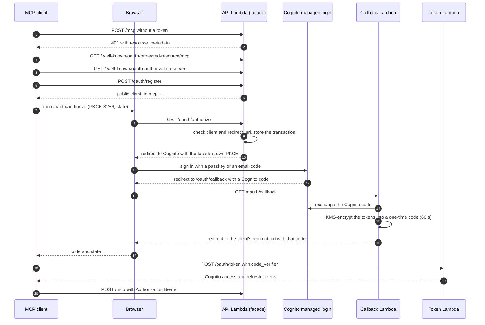

# Using the MCP server

kiro-remote exposes an MCP server two ways, both backed by the same REST API and
the same `KiroRemoteClient` interface:

- **stdio** — the `kiro-remote mcp` command, which speaks MCP over stdio and calls
  the REST API with _your_ OAuth token (refreshing it silently).
- **Streamable HTTP** — mounted at `<host>/mcp`, a protected resource that
  requires the same Cognito bearer.

Both surfaces expose the same **19 tools**.

## The `kiro-remote` CLI

The CLI lives in `packages/mcp` (private workspace package `@nikovirtala/kiro-remote-mcp`, bin
name `kiro-remote`, entry
[`packages/mcp/src/cli.ts`](../packages/mcp/src/cli.ts)). Commands:

| Command              | What it does                                                                                                                                                                                                         |
| -------------------- | -------------------------------------------------------------------------------------------------------------------------------------------------------------------------------------------------------------------- |
| `kiro-remote login`  | OAuth authorization-code + PKCE against the facade (CIMD `client_id` `https://<host>/oauth/clients/cli.json`, loopback redirect on an ephemeral port). Stores tokens in the OS keychain with a `0600` file fallback. |
| `kiro-remote logout` | Revoke the refresh token and clear stored tokens.                                                                                                                                                                    |
| `kiro-remote whoami` | Print the caller's `sub` and scopes.                                                                                                                                                                                 |
| `kiro-remote mcp`    | Run the stdio MCP transport over the REST API, refreshing tokens silently.                                                                                                                                           |

### Required environment variable

The CLI needs exactly one variable:

- **`KIRO_REMOTE_URL`** — the facade / REST API public base URL (the same value as
  the stack's `publicBaseUrl`). If it is unset, the CLI exits with code **2**.

No secret is ever passed on the command line.

### Running the CLI from the workspace

The package is a private workspace package, so run its bin through pnpm:

```bash
export KIRO_REMOTE_URL=https://<host>

# Log in once (opens managed login in your browser, sign in with your passkey).
mise exec -- pnpm --filter @nikovirtala/kiro-remote-mcp exec kiro-remote login

# Confirm who you are.
mise exec -- pnpm --filter @nikovirtala/kiro-remote-mcp exec kiro-remote whoami
```

(If you manage Node/pnpm yourself, drop the `mise exec --` prefix.)

## Wiring stdio into an MCP client

After `kiro-remote login` has stored your tokens, register `kiro-remote mcp` as a
**stdio** MCP server in your client, with `KIRO_REMOTE_URL` set in its environment.
The exact file differs per client; the shape is the same. For example, a
Claude Desktop-style `mcpServers` entry:

```json
{
  "mcpServers": {
    "kiro-remote": {
      "command": "mise",
      "args": [
        "exec",
        "--",
        "pnpm",
        "--filter",
        "@nikovirtala/kiro-remote-mcp",
        "exec",
        "kiro-remote",
        "mcp"
      ],
      "env": {
        "KIRO_REMOTE_URL": "https://<host>"
      }
    }
  }
}
```

Set `command`/`args` to whatever invokes `kiro-remote mcp` in your environment (the
pnpm form above works from the workspace; a globally linked `kiro-remote` binary
would simply be `"command": "kiro-remote", "args": ["mcp"]`). The server reads your
stored tokens and refreshes them silently, so you do not pass any secret in the
config.

## Using Streamable HTTP directly

If your MCP client speaks Streamable HTTP, point it at `<host>/mcp`. That endpoint
is a protected resource: it requires `Authorization: Bearer <token>` (the same
Cognito access token as the REST API) and advertises its OAuth requirements via the
`/.well-known/oauth-protected-resource/mcp` document.

### Authenticating a remote MCP client

A remote MCP client (for example a Claude custom connector) authenticates through
the facade's OAuth before it can call `<host>/mcp`. It can obtain a `client_id`
three ways:

- **Dynamic Client Registration (RFC 7591)** — an unauthenticated
  `POST /oauth/register` that returns an opaque public `client_id` (prefix `mcp_`,
  no client secret, `token_endpoint_auth_method: "none"`). This is what a client's
  "Register automatically" option uses; the RFC 8414 authorization-server metadata
  advertises it as the `registration_endpoint` (`<host>/oauth/register`).
  A registration lasts 180 days and is extended (at most once a day) each time the
  client signs in at `/oauth/authorize` or refreshes with its `client_id`. A client
  whose registration has expired is unknown: `/oauth/authorize` shows an
  `invalid_client` error page (it cannot redirect to an unverified `redirect_uri`),
  and a refresh that presents its `client_id` returns `invalid_client`, which MCP
  clients take as the signal to register again. Registrations made before this
  limit existed have no expiry.
- **A CIMD URL `client_id`** — a client-id-metadata-document URL whose host is
  allow-listed via the construct's `cimdAllowedHosts`. The metadata advertises
  `client_id_metadata_document_supported: true`.
- **The pre-registered CLI client** — the CIMD document at
  `<host>/oauth/clients/cli.json` that `kiro-remote login` uses.

Regardless of which `client_id` is used, and regardless of what scope the client
requests, the token the client receives always carries the MCP resource scopes
(`openid` plus `sessions:read` / `sessions:write` / `sessions:delete`), because the
facade forwards the resource scopes to Cognito.

### The sign-in flow

A remote client that registers itself goes through these requests. The facade
runs its own PKCE exchange with Cognito, so the client never talks to Cognito
directly, and it returns Cognito's tokens unchanged (Cognito is the only
issuer).



`kiro-remote login` runs the same flow with two differences: its `client_id` is
the CIMD URL `<host>/oauth/clients/cli.json` (no registration step), and its
`redirect_uri` is a loopback address on an ephemeral port. A refresh
(`grant_type=refresh_token`) goes from the client to `/oauth/token`, which
passes it to Cognito (after checking that a registered `client_id`, if one is
sent, is still registered). The `state` of a sign-in is single-use: a second
`/oauth/callback` with the same `state`, or one more than 10 minutes after
`/oauth/authorize`, is refused like an unknown state.

### Trying it in the MCP Inspector

The [MCP Inspector](https://modelcontextprotocol.io/docs/2026-07-28/tools/inspector#remote-http-server)
web UI is a quick way to browse the tools and call them by hand against the
deployed endpoint:

```bash
npx @modelcontextprotocol/inspector --server-url https://<host>/mcp --transport http
```

When `/mcp` answers 401, the Inspector runs the OAuth discovery, registers an
`mcp_` client through Dynamic Client Registration and opens the Cognito sign-in,
the same way Claude does. By default it stores the resulting tokens in the OS
keychain, or unencrypted in `~/.mcp-inspector/secrets.json` on a machine
without one; see the Inspector's
[secret storage notes](https://modelcontextprotocol.io/docs/2026-07-28/tools/inspector/configuration.md#where-secrets-are-stored).
The live e2e harness uses the Inspector's CLI mode instead, with an in-memory
store (see [`docs/testing.md`](testing.md#the-live-end-to-end-harness)).

## The 19 tools

Stable order, with annotations `RO` = `readOnlyHint`, `DESTRUCTIVE` =
`destructiveHint` (from [`packages/mcp/src/tools.ts`](../packages/mcp/src/tools.ts)):

| #   | Tool                                 | Annotation  | What it does                                                                                                                           |
| --- | ------------------------------------ | ----------- | -------------------------------------------------------------------------------------------------------------------------------------- |
| 1   | `kiro_capabilities`                  | RO          | Advertised capabilities, `kiro-cli` version (`null` until the caps publisher has run), your active session count.                      |
| 2   | `kiro_list_models`                   | RO          | Model ids the agent advertises.                                                                                                        |
| 3   | `kiro_launch_session`                | —           | Launch a session against one or more repos with an initial prompt.                                                                     |
| 4   | `kiro_list_sessions`                 | RO          | List your sessions, newest first, with status filter + cursor.                                                                         |
| 5   | `kiro_adopt_session`                 | —           | Adopt an existing Kiro cloud session.                                                                                                  |
| 6   | `kiro_get_session`                   | RO          | Fetch one session you own, with its linked PRs (`links`), the PRs it waits for (`waits`) and its prompt `queue`.                       |
| 7   | `kiro_send_prompt`                   | —           | Send a prompt; steer/queue/reject when busy ([the queue](#the-prompt-queue-kiro_send_prompt-with-whenbusy)).                           |
| 8   | `kiro_wait_for_events`               | RO          | Long-poll the event log (see limits below).                                                                                            |
| 9   | `kiro_get_transcript`                | RO          | The assistant's final text per completed turn.                                                                                         |
| 10  | `kiro_list_permissions`              | RO          | List permission requests (optionally by status).                                                                                       |
| 11  | `kiro_answer_permission`             | —           | Answer a pending request with an offered `optionId` (+ optional consent).                                                              |
| 12  | `kiro_set_config`                    | —           | Change a session's `model` / `effort` / `mode`.                                                                                        |
| 13  | `kiro_link_pull_request`             | —           | Link a PR (`owner/repo#n` or URL) to a session so GitHub activity wakes it ([GitHub wake](./github.md)).                               |
| 14  | `kiro_unlink_pull_request`           | —           | Remove a PR link from a session.                                                                                                       |
| 15  | `kiro_wait_for_pull_request`         | —           | Wake the session once when a PR it depends on but does not own merges or closes ([waits for](./github.md#waiting-for-a-pull-request)). |
| 16  | `kiro_stop_waiting_for_pull_request` | —           | Remove a wait.                                                                                                                         |
| 17  | `kiro_list_events`                   | RO          | The change feed: link and wait changes and every wake with its cause, after a cursor ([change feed](./github.md#the-change-feed)).     |
| 18  | `kiro_cancel_turn`                   | DESTRUCTIVE | Cancel the active turn.                                                                                                                |
| 19  | `kiro_delete_session`                | DESTRUCTIVE | Permanently delete a session and its cloud sandbox.                                                                                    |

`kiro_wait_for_pull_request` and `kiro_stop_waiting_for_pull_request` take
`{ sessionId, pr }` and need `sessions:write`, like the link tools. A session can
wait for any number of pull requests, and a pull request can be waited for by
any number of sessions; see [waiting for a pull
request](./github.md#waiting-for-a-pull-request). `kiro_get_session` returns the
session's `waits`.

`kiro_list_events { after, limit }` reads the account's [change
feed](./github.md#the-change-feed) (`after` is the `nextCursor` of the last page,
`0` to start; `limit` defaults to 50, at most 200) and needs `sessions:read`.

### Retrying safely: `idempotencyKey`

Every tool that changes something (`kiro_launch_session`, `kiro_adopt_session`,
`kiro_send_prompt`, `kiro_answer_permission`, `kiro_set_config`,
`kiro_link_pull_request`, `kiro_unlink_pull_request`,
`kiro_wait_for_pull_request`, `kiro_stop_waiting_for_pull_request`, `kiro_cancel_turn`,
`kiro_delete_session`) takes an optional `idempotencyKey`: 1 to 128 characters
from `A-Z a-z 0-9 . _ ~ : -`. Send the same key on every retry of one call and
it runs at most once in 24 hours. A replay returns the first call's result and
enqueues nothing. The key is scoped to your sub, and read-only tools have none.

- **Same key, same input:** the stored result of the first call.
- **Same key, different input** (another tool, session or argument): a tool
  error, `this idempotency key was already used for a different request`. Use a
  new key for a new request.
- **A failed call is not stored**, so retrying it with the same key runs it again.
- **No key:** nothing changes. The stdio CLI still sends a fresh
  `Idempotency-Key` header on writes that always had one, so only a key you
  choose makes a retry safe.

Both transports share one implementation with the REST API
([`withIdempotency`](../packages/api/src/idempotency.ts)): the stdio CLI sends the
key as the `Idempotency-Key` header, and `/mcp` wraps its direct service call.
A key stored over one transport is not meant to be replayed over the other: the
stored result has that transport's shape, so the fingerprint differs and the
replay is refused.

**On cloud sessions.** Every session the bridge launches is a Kiro cloud
session, and some tools have no effect there:

- `kiro_list_models` returning no models is expected for cloud and autonomous
  sessions.
- `kiro_adopt_session` is rejected.
- `kiro_set_config` is a logged no-op.
- `kiro_list_permissions` always returns an empty list, so
  `kiro_answer_permission` never has a pending request to answer: cloud turns
  never ask for permission.
- `kiro_cancel_turn` is rejected while a turn is running and is a no-op when
  the session is idle.
- `kiro_send_prompt` with `whenBusy: "steer"` (the default) fails in the call
  while a turn is running (`steer_unsupported`). Use `"queue"` to run the prompt
  after the turn, or `"reject"` and send it once the turn settles.

A rejected cancel shows up in `kiro_wait_for_events` as a `turn.failed` event with
`rawType: "operation_rejected"`. See
[Operations cloud sessions do not support](./deploy.md#operations-cloud-sessions-do-not-support).

### The prompt queue: `kiro_send_prompt` with `whenBusy`

A cloud turn cannot be interleaved with, so a session is **busy** while a turn
runs and while prompts are queued. `whenBusy` says what a busy session does with
a new prompt (it defaults to `steer`):

| `whenBusy` | Busy session                                                                                                                                                        | Idle session, nothing queued |
| ---------- | ------------------------------------------------------------------------------------------------------------------------------------------------------------------- | ---------------------------- |
| `queue`    | The prompt waits on the session's queue and runs as **its own turn**, after the turn in front of it. The answer is `{ turn: { id, status: "queued" } }`.            | Runs now as a turn.          |
| `reject`   | Refused in the call: a tool error (REST: 409). Nothing is stored.                                                                                                   | Runs now as a turn.          |
| `steer`    | Refused in the call, like `reject`: a tool error (REST: 409) with `reason: steer_unsupported` and a hint to use `queue`. Nothing is stored, the queue is untouched. | Runs now as a turn.          |

`steer` is the default, so a call without `whenBusy` on a busy cloud session fails
the same way. Send the prompt with `whenBusy: "queue"` to have it run after the turn.

**What `queue` guarantees.** `turn.id` in the answer is the id the prompt runs
under, and the prompt ends in one of two ways, never silently:

- **It runs**, as a turn with that id, **once** and **in order**: prompts run
  oldest first, one at a time, each after the turn in front of it has ended
  (including a turn that ran longer than one Lambda invocation). A GitHub wake
  waits for the queue: the wake runs after the last queued prompt.
- **It fails**, with a reason, where you can see it:
  - `kiro_wait_for_events` shows a `turn.failed` event with `turnId` set to the
    prompt's id and `rawType: "queued_prompt_failed"`; its payload has
    `reason` (and never the prompt's text);
  - `kiro_get_session` lists the queue (below), the prompt with
    `status: "failed"` and `reason`;
  - the [change feed](./github.md#the-change-feed) has a `prompt.failed`
    annotation `{ turnId, whenBusy, reason }`.

| `reason`          | Why                                                                                                     |
| ----------------- | ------------------------------------------------------------------------------------------------------- |
| `session_deleted` | The session was deleted while the prompt waited (by you, or found deleted).                             |
| `session_failed`  | The session never provisioned, so nothing can run.                                                      |
| `not_sent`        | The prompt was stored but could not be sent to the bridge; the call returned an error. It will not run. |

**`kiro_get_session` shows the queue.** `queue` lists, oldest first, every prompt
still to run and the latest that started or failed, each as
`{ turnId, status, queuedAt, reason }`. `status` is `queued` (waiting for the
turn in front of it), `delivered` (handed to the bridge, its turn is about to
start), `started` (its turn exists: follow `turnId` on the event log) or
`failed` (`reason` says why). Records are kept for 7 days.

**How `steer` and `queue` combine.** A steer is a prompt for the turn that is
running, and a cloud turn takes none. A session is busy while a turn runs and
while prompts are queued, and a steer for a busy session fails in the call
(`steer_unsupported`, 409 over REST, a tool error over MCP): it is not stored, it
does not start a turn ahead of the queue and it removes nothing from it, so every
queued prompt still runs, in order. A steer to an idle session with nothing queued
is an ordinary prompt. In the one case the call cannot see, a session that looked
idle when you called and was busy when the bridge read the command (another prompt
got in first), the bridge keeps the steer on the queue behind what is in front of
it instead of rejecting it, so it runs after them and shows in `queue` as `queued`;
the answer you got was `running` because the session was idle then. It never
ends as a silent rejection.

**Deleting and closing.** `kiro_delete_session` fails each queued prompt first
(`session_deleted`, visible at once in `kiro_get_session`), then deletes. A
session with queued prompts is never deleted or closed automatically: when
`GITHUB_AUTO_CLOSE_ON_MERGE` is on and a post-merge turn finishes while prompts
are queued, the close waits and is decided again after the last queued prompt
has run (it is still skipped if a linked PR is open).

### `kiro_wait_for_events` limits

The poller is tuned so an agent can poll cheaply: it waits at most **20 seconds**,
returns at most **30 events** and **8000 characters** of text (reporting any
truncation), and includes `nextCursor`, `turnStatus`, and the pending-permission
count.

### `kiro_get_transcript`

Returns the assistant's **final** text for each completed turn (not the raw event
stream), which is usually what you want to read back. Each turn has a `trigger`:
`{ source: "user", deliveryIds: [] }` for a turn you started, or
`{ source: "github", deliveryIds: [...] }` for a turn a GitHub event woke (see
[GitHub wake](./github.md)).

## The skill and the protocol eras

### The `kiro-remote-sessions` skill

Both surfaces serve a skill that teaches a model to hand coding work to a Kiro
cloud session with these tools: the launch, wait and transcript loop, what
`turnStatus` says, the limits of one wait, `whenBusy: "queue"` for follow-ups,
what does nothing on a cloud session, one `idempotencyKey` per logical call,
linking and waiting for pull requests, and the asynchronous delete. It uses the
[Skills extension](https://modelcontextprotocol.io/extensions/skills/overview)
(`io.modelcontextprotocol/skills`, SEP-2640): a client that supports it finds
the skill with `skills/list` and loads `skill://kiro-remote-sessions/SKILL.md`
and the files under `references/` when it needs them. Claude (web), Claude Code
and VS Code Copilot support the extension; Claude Desktop and Kiro do not, and
get a short `instructions` text instead (in `initialize` and `server/discover`,
under 600 characters) that names the loop, `whenBusy: "queue"`, idempotency keys
and the skill URI.

- **Where it lives.** One folder per skill under
  [`packages/mcp/skills`](../packages/mcp/skills), each with a `SKILL.md`
  (frontmatter `name`, which must be the folder name, and `description`) and
  optional `references/` (Biome does not format `SKILL.md`: it would put a blank
  line inside the frontmatter). Adding a skill is adding a folder: the catalog serves
  every folder, and the API bundle embeds them at build time
  ([`embed-skills.ts`](../packages/cdk/src/embed-skills.ts)), because the Lambda
  has no folder to read at run time.
- **Who may read it.** Any authenticated caller, whatever its scopes: the content
  is the same for every user and holds no data. An unauthenticated request still
  gets the 401 challenge, in both eras. Answers carry `ttlMs: 300000` and
  `cacheScope: "public"` (`SKILLS_CACHE_HINT` in
  [`skills.ts`](../packages/mcp/src/skills.ts)).
- **What is checked.** `packages/mcp/test/skills-content.test.ts` holds the rule
  that a skill only names what exists, over every folder: each `kiro_*` tool is
  in `tools.ts`, each `whenBusy` value and tool argument is in that tool's schema,
  each link resolves, and nothing deployment-specific is in the text. The Inspector
  checks the served manifest ([testing](testing.md#the-mcp-servers-against-the-inspector-offline)).
- **Trying it.** `npx @modelcontextprotocol/inspector@2.16.0 --cli <url>/mcp
  --transport http --method skills/list --verify` (after signing in),
  `--method skills/get --uri skill://kiro-remote-sessions/SKILL.md`, or
  `--method initialize` for the instructions.

### Protocol eras

`/mcp` and the stdio server speak two eras from one server factory
([`createMcpServerFactory`](../packages/mcp/src/server.ts), on
`@modelcontextprotocol/server` 2.x):

| Era        | A request is                                                                                                                      | Served by                                                |
| ---------- | --------------------------------------------------------------------------------------------------------------------------------- | -------------------------------------------------------- |
| 2026-07-28 | self-contained: `MCP-Protocol-Version` and `Mcp-Method` headers and a `_meta` envelope; `server/discover` instead of `initialize` | a fresh server per request                               |
| 2025       | `initialize` (2025-06-18 and 2025-11-25), then `tools/list`, `tools/call`                                                         | the SDK's stateless fallback, a fresh server per request |

Both eras return the same 19 tools, byte for byte
(`packages/mcp/test/fixtures/tools-list.json`), the same `insufficient_scope`
JSON-RPC error for a missing scope and `isError: true` for a tool that fails.
The API authenticates a request before it reaches either era. The legacy handling
is one constant (`LEGACY` in [`http-transport.ts`](../packages/mcp/src/http-transport.ts));
changing it to `"reject"` retires the 2025 era.

The `/mcp` seam is request and response, so it serves no streams:
`subscriptions/listen` is refused (`-32601`), `GET` answers 405, and the server
advertises `listChanged: false`. Extensions attach in one place
([`extensions.ts`](../packages/mcp/src/extensions.ts)).

## Tasks: the turn's answer as the tool result

A client that supports the
[Tasks extension](https://modelcontextprotocol.io/extensions/tasks/overview)
(`io.modelcontextprotocol/tasks`, SEP-2663) does not have to drive
`kiro_wait_for_events` and `kiro_get_transcript` itself. It calls
`kiro_send_prompt`, the server answers with a **task handle** for the Kiro turn,
the client polls `tasks/get` on its own, and the model receives the turn's final
text as the tool result. Claude (web) and Claude Code support the extension.

Everything here is 2026-07-28 only. A 2025-era client gets the tool results it
always got, and `tasks/get`, `tasks/update` and `tasks/cancel` answer `-32601`
on that era. The module is
[`packages/mcp/src/tasks/`](../packages/mcp/src/tasks), written to the design of
the SDK's own `ext/tasks`
([typescript-sdk#2782](https://github.com/modelcontextprotocol/typescript-sdk/pull/2782),
not released) so that the swap is mechanical.

**Which calls return a task.** `kiro_send_prompt`, when the request declares the
extension in its `_meta` client capabilities **and** the prompt left a stored
record before the call answered. That is a prompt sent with `whenBusy: "queue"`
(its queue row is written first). A `steer` or `reject` prompt to an idle
session is only a command on its way to the bridge until the bridge writes the
turn row, so there is nothing a `tasks/get` could read: it answers `{ turn }`
as without Tasks. `kiro_launch_session` returns no task yet (its answer has no
turn id until the sandbox starts), and a GitHub wake turn has none, since no
tool call starts it. The other 17 tools, and every tool schema, are unchanged.

**The task id** is opaque: it encodes the session id, the turn id, the creation
time and the TTL, so `tasks/get` needs no lookup table (the API Lambda keeps no
state between requests). A malformed id is `-32602 Task not found`.

**Status.** A task reads the same records as `GET /sessions/{id}/turns/{turnId}`
(the turn row, or the queued prompt while it waits):

| Turn                 | Task        | Detail                                                                                                                                                                        |
| -------------------- | ----------- | ----------------------------------------------------------------------------------------------------------------------------------------------------------------------------- |
| `queued`, `running`  | `working`   | `statusMessage` says which.                                                                                                                                                   |
| `completed`          | `completed` | `result` is a tool result: the turn's final text (what `kiro_get_transcript` gives for that turn) and `structuredContent { sessionId, turnId, status }`.                      |
| `failed`, `refused`  | `failed`    | `error` is `-32603` with `data { sessionId, turnId, status, reason }`. A prompt that failed on the queue gives `session_deleted`, `session_failed` or `not_sent` as `reason`. |
| `cancelled`          | `cancelled` |                                                                                                                                                                               |
| any, session deleted | `failed`    | `reason: session_deleted`, as long as the session's records exist. A turn that had already failed or been cancelled keeps its own status.                                     |

`input_required` is never used: a cloud turn does not ask for input. `tasks/update`
acknowledges any `inputResponses`, since every key is one the task never issued,
and ignores them.

The text is not cut: it is exactly what `kiro_get_transcript` returns for the
turn, which has no bound of its own (only the event pages it reads).

**Who may read a task.** Only the session's owner. Another user's task id, a
task of a deleted session whose records are gone, an expired task and a task id
that never existed all answer `-32602 Task not found`, so a task id does not
reveal whether it exists. `tasks/*` do not check the scope of the tool that
created the task; they read as the caller, so `sessions:read` is needed
(`insufficient_scope` otherwise), and cancelling needs `sessions:write`, as
`kiro_cancel_turn` does. A request that does not declare the extension is
refused with `-32021` (HTTP 400) and `data.requiredCapabilities`, whether or not
the task exists.

**Cancelling.** `tasks/cancel` is cooperative and answers with an empty result.
For a running turn it makes the same call as `kiro_cancel_turn`; a cloud session
refuses a cancel while its turn runs, so the task then reaches `completed` or
`failed` by itself. Nothing is sent for a turn that has settled, nor for a
prompt still waiting on the queue (a cancel acts on the session's running turn,
which is another turn).

**Polling and retention.** Each task carries `pollIntervalMs: 5000` and
`ttlMs: 86400000` (24 hours), both in
[`constants.ts`](../packages/mcp/src/tasks/constants.ts). A follow-up turn takes
about 9 seconds, so polling faster only costs requests. Turn rows have no TTL of
their own, so the 24 hours is the task handle's: after it the id is `Task not
found`, and the answer stays readable with `kiro_get_transcript`.
`notifications/tasks` is not sent (the `/mcp` seam has no stream): clients poll.

**Both transports.** `/mcp` and `kiro-remote mcp` (stdio) serve the extension
from the same server factory, and per-request client capabilities travel in each
2026-07-28 request on both. One difference: the stdio server reads through the
REST API, which hides a deleted session, so there a task of a deleted session is
`Task not found` at once instead of `failed`.

**Trying it.** `packages/mcp/test/tasks-interop.test.ts` drives both transports
with the extension's own requester (`@modelcontextprotocol/ext-tasks/client`),
and the live e2e harness does the same against the deployed `/mcp`
([testing](testing.md)).

## Scopes and secrets

MCP calls use your Cognito OAuth token and are gated by the same scopes as the REST
API (`sessions:read` / `sessions:write` / `sessions:delete`). The `ksk_`
`KIRO_API_KEY` is never used here; it is only the bridge's credential for Kiro,
read by the bridge Lambda functions.
