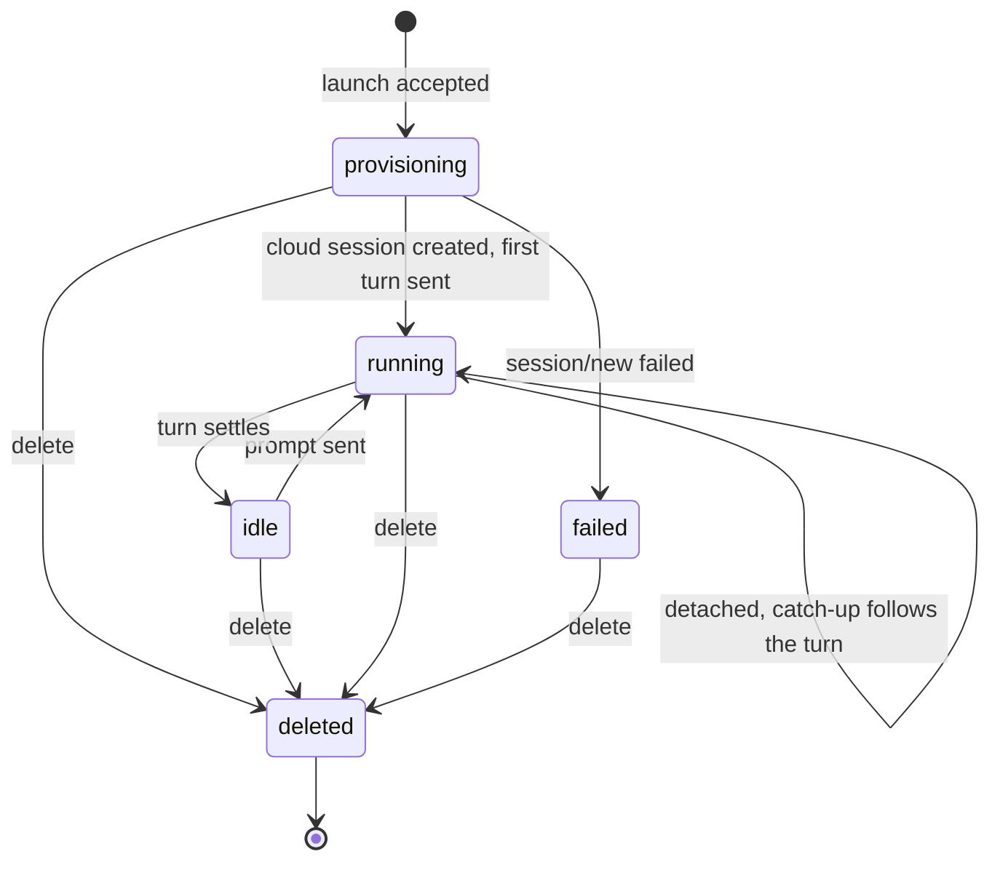

# Trying the REST API

The REST API is served by API Gateway + Lambda at base path `/v1`, with an
unauthenticated OAuth facade and discovery endpoints at the host root. The full,
authoritative contract is the OpenAPI 3.1 document at `<host>/openapi.json`.

The routes below come directly from the router
([`packages/api/src/router.ts`](../packages/api/src/router.ts)) and the facade
([`packages/api/src/facade.ts`](../packages/api/src/facade.ts)).

## Authentication

Every `/v1/*` route requires a **Cognito OAuth access token** as
`Authorization: Bearer <token>`. This is the token you get from
`kiro-remote login` (see [users.md](./users.md)); it is **not** the `ksk_`
`KIRO_API_KEY` (that key is only the bridge's credential for Kiro, read by the bridge Lambda
functions, and is never a REST/MCP bearer).

Scopes gate access: reads need `sessions:read`, writes need `sessions:write`,
delete needs `sessions:delete`. A session is visible only to its creator's sub.

## Authenticated routes (under `/v1`)

| Method | Path                                         | Notes                                                                                                                                                                                                                |
| ------ | -------------------------------------------- | -------------------------------------------------------------------------------------------------------------------------------------------------------------------------------------------------------------------- |
| GET    | `/v1/capabilities`                           | Advertised capabilities, `kiro-cli` version (`kiroCliVersion`, `null` until the caps publisher has run; see below), active session count.                                                                            |
| GET    | `/v1/models`                                 | Model ids the agent advertises.                                                                                                                                                                                      |
| GET    | `/v1/sessions`                               | List your sessions. Query: `status`, `limit` (default 20, max 100), `cursor`.                                                                                                                                        |
| POST   | `/v1/sessions`                               | Launch a session. Returns **202** `{ sessionId, turnId }`; `turnId` is `null` until the bridge starts the first turn.                                                                                                |
| POST   | `/v1/sessions/adopt`                         | Adopt an existing Kiro session. Body `{ kiroSessionId }`.                                                                                                                                                            |
| GET    | `/v1/sessions/{id}`                          | Fetch one session.                                                                                                                                                                                                   |
| DELETE | `/v1/sessions/{id}`                          | Delete a session (needs `sessions:delete`).                                                                                                                                                                          |
| POST   | `/v1/sessions/{id}/turns`                    | Send a prompt. Returns **202**.                                                                                                                                                                                      |
| GET    | `/v1/sessions/{id}/turns/{turnId}`           | Fetch a turn.                                                                                                                                                                                                        |
| GET    | `/v1/sessions/{id}/events`                   | Long-poll the event log. Query: `after=<seq>`, `wait=<0..20s>`, `types`. Returns `{ events, nextCursor, turnStatus }`.                                                                                               |
| POST   | `/v1/sessions/{id}/cancel`                   | Cancel the active turn.                                                                                                                                                                                              |
| GET    | `/v1/sessions/{id}/permissions`              | List permission requests. Query: `status=pending`.                                                                                                                                                                   |
| POST   | `/v1/sessions/{id}/permissions/{requestId}`  | Answer a permission. Body `{ optionId, consent? }`. 422 if `optionId` was not offered.                                                                                                                               |
| PATCH  | `/v1/sessions/{id}/config`                   | Change `model` / `effort` / `mode`.                                                                                                                                                                                  |
| POST   | `/v1/sessions/{id}/links`                    | Link a pull request by hand. Body `{ pr: "owner/repo#n" \| "<PR URL>" }`. **201** new, **200** already linked to this session, **409** linked to another session, **403** repo not in the session. `sessions:write`. |
| DELETE | `/v1/sessions/{id}/links/{owner}/{repo}/{n}` | Remove a PR link (**204**). `sessions:write`.                                                                                                                                                                        |
| GET    | `/v1/github/unmatched`                       | Recent GitHub deliveries for allowed repos that matched no session link. Query: `limit` (default 20, max 100). `sessions:read`.                                                                                      |

**On cloud sessions.** Every session the bridge launches is a Kiro cloud
session, and some routes have no effect there:

- `GET /v1/models` returning no models is expected for cloud and autonomous
  sessions.
- `POST /v1/sessions/adopt` is accepted, but the bridge rejects the adopt.
- `PATCH /v1/sessions/{id}/config` is a logged no-op.
- `GET /v1/sessions/{id}/permissions` always returns an empty list, so there
  is never a pending request to answer: cloud turns never ask for permission.
- `POST /v1/sessions/{id}/cancel` is rejected while a turn is running and is a
  no-op when the session is idle.
- `POST /v1/sessions/{id}/turns` with `whenBusy: "steer"` or `"queue"` is
  rejected while a turn is running; use `"reject"` and send the prompt once
  the turn settles.

A rejection appears in `GET /v1/sessions/{id}/events` as a `turn.failed` event
with `rawType: "operation_rejected"`. See
[Operations cloud sessions do not support](./deploy.md#operations-cloud-sessions-do-not-support).

`kiroCliVersion` comes from `agentInfo.version` in the ACP `initialize` result
the bridge persists as `CONFIG#CAPS` (the same value backs the MCP
`kiro_capabilities` tool). On the Lambda bridge, the engine's own `initialize`
result has no `agentInfo`, so the caps publisher records the kiro-cli version
the image was built from (its `KIRO_CLI_VERSION` build arg) instead. It is
`null` — never a guessed value — until the caps publisher has run at least once,
or if neither the agent nor the image reports a version.

`GET /v1/sessions/{id}` also returns `links[]` (the PRs linked to the session,
each with `linkedBy`: `harvest`, `trailer` or `manual`), and
`GET /v1/sessions/{id}/turns/{turnId}` returns `trigger`
(`{ source: "user" | "github", deliveryIds }`) and `prompt`, the prompt the
turn ran with: what you sent, or for a GitHub wake the prompt kiro-remote
rendered (so you can see which text was quoted and which was withheld). The links and the GitHub-woken
turns exist only when the optional [GitHub wake](./github.md) is deployed.

### Request-body shapes

- **POST `/v1/sessions`**: `{ prompt, repos[], title?, mode?, model?, effort? }`.
  `prompt` is required and non-empty; `repos` is a non-empty array of `owner/name`
  strings (and must match the stack's `allowedRepos` glob or the launch is
  rejected with 403).
- **POST `/v1/sessions/{id}/turns`**:
  `{ prompt, whenBusy: "steer" | "queue" | "reject" }` (`whenBusy` defaults to
  `steer`).
- **POST `/v1/sessions/adopt`**: `{ kiroSessionId }`.
- **PATCH `/v1/sessions/{id}/config`**: `{ model?, effort?, mode? }`.
- **POST `/v1/sessions/{id}/permissions/{requestId}`**: `{ optionId, consent? }`.

### Conventions

- Every `POST` accepts an **`Idempotency-Key`** header, stored for 24h and scoped
  to your sub, so a retried write is not applied twice.
- Writes enqueue a command and return **202**; reads are served from DynamoDB.
- Errors are **RFC 9457** `application/problem+json`.
- A route whose extension the server does not advertise returns **501**
  (`type: capability-unavailable`).

### Session status

A session's `status` (also the `GET /v1/sessions?status=` filter) moves like
this on the cloud bridge:



- A launch creates the cloud session and starts its first turn in the same
  command, so a new session goes from `provisioning` straight to `running`.
- A turn settles as `completed`, `failed`, `refused` or `cancelled`; the
  session returns to `idle` in every case. A catch-up that sees no `turn_end`
  within 6 h fails the turn (`catch_up_expired`), and the session is `idle`
  again.
- `failed` means the cloud session could not be created, so there is nothing to
  prompt; delete the session and launch a new one.
- `DELETE /v1/sessions/{id}` answers `status: "deleting"`; the row reads
  `deleted` once the bridge has deleted the cloud session.
- `awaiting_permission` is part of the schema, but cloud turns never ask for
  permission, so a cloud session never enters it.

## Unauthenticated discovery / facade endpoints (host root, not under `/v1`)

| Method | Path                                        | Purpose                                                                                            |
| ------ | ------------------------------------------- | -------------------------------------------------------------------------------------------------- |
| GET    | `/.well-known/oauth-protected-resource/mcp` | RFC 9728 Protected Resource Metadata.                                                              |
| GET    | `/.well-known/oauth-authorization-server`   | RFC 8414 Authorization Server metadata.                                                            |
| GET    | `/oauth/authorize`                          | Start the authorization-code flow.                                                                 |
| GET    | `/oauth/callback`                           | OAuth redirect callback.                                                                           |
| POST   | `/oauth/register`                           | RFC 7591 Dynamic Client Registration (public PKCE client; returns an `mcp_` client_id, no secret). |
| POST   | `/oauth/token`                              | Exchange a code (or refresh) for tokens.                                                           |
| POST   | `/oauth/revoke`                             | Revoke a refresh token.                                                                            |
| GET    | `/oauth/clients/cli.json`                   | The CLI's CIMD client metadata document.                                                           |
| GET    | `/openapi.json`                             | The OpenAPI 3.1 contract (OAuth2 authorizationCode scheme).                                        |

The Streamable HTTP **MCP server** is mounted at `/mcp` and is a protected
resource (it requires the same bearer). See [mcp.md](./mcp.md).

> The MCP tool input schemas, the REST request validation, and the `/openapi.json`
> document are all generated from the **same** core zod objects
> ([`packages/core/src/schemas`](../packages/core/src/schemas)), so the contract
> you read in `/openapi.json` is exactly what the API enforces.

## A `curl` walkthrough

First, get a token. The easiest way is the CLI:

```bash
export KIRO_REMOTE_URL=https://<host>
mise exec -- pnpm --filter @nikovirtala/kiro-remote-mcp exec kiro-remote login
```

Alternatively, drive the discovery → authorize → token chain yourself using the
`/.well-known/*` and `/oauth/*` endpoints above; the order of the requests is
in [the sign-in flow](./mcp.md#the-sign-in-flow).

Once you have an access token, set it and call the API. (Replace `<token>` with
the Cognito access token, not your `ksk_` key.)

```bash
HOST=https://<host>
TOKEN=<token>

# 1. Confirm the token works and see capabilities.
curl -sS -H "Authorization: Bearer $TOKEN" "$HOST/v1/capabilities"

# 2. Launch a session (202 with { sessionId, turnId: null }). Idempotency-Key is optional.
curl -sS -X POST "$HOST/v1/sessions" \
  -H "Authorization: Bearer $TOKEN" \
  -H "Content-Type: application/json" \
  -H "Idempotency-Key: $(uuidgen)" \
  -d '{"prompt":"Summarize the README.","repos":["owner/repo"]}'

# 3. Long-poll the event log. Start at after=0, then pass the returned
#    nextCursor as the next "after". wait is 0..20 seconds.
curl -sS -H "Authorization: Bearer $TOKEN" \
  "$HOST/v1/sessions/<sessionId>/events?after=0&wait=20"
```

Repeat step 3 with the `nextCursor` value to keep long-polling. Check
`turnStatus` in the response to know when the turn has completed. Cloud turns
never ask for permission, so there is no pending request to answer.

Keep real secrets out of commands and notes: use placeholders like `owner/repo`
and `ksk_xxxxxxxx`.
